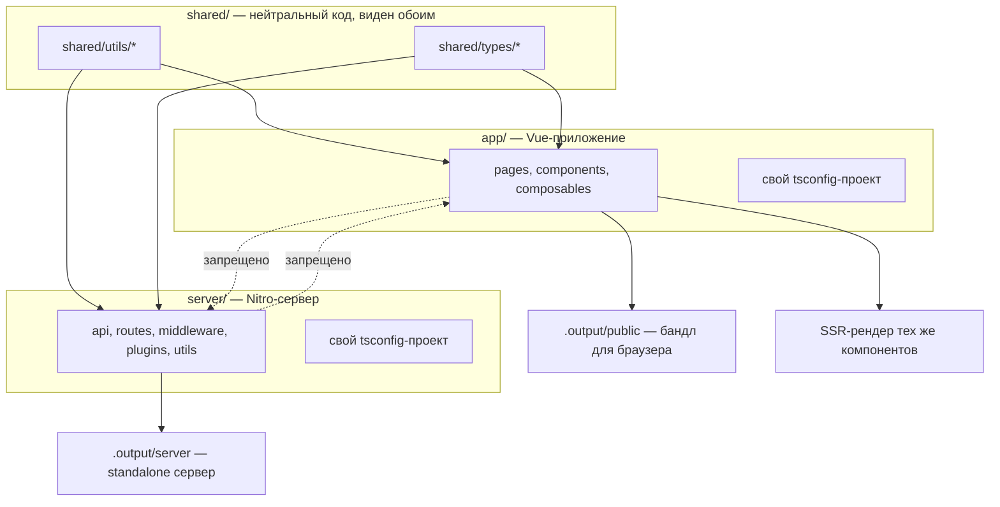

# Урок 01. Два рантайма

> **Идея в трёх строках**
> - `nuxt build` собирает не одно приложение, а два независимых бандла: Vue-приложение и сервер Nitro.
> - `app/` и `server/` — разные контексты: разные автоимпорты, разные `tsconfig`-проекты, разные доступные API.
> - Мост между ними ровно один — `shared/`, и он тоже не всесилен.

**Зачем это первым уроком.** Почти все «странные» ошибки бэкенда в Nuxt — не про
Nitro и не про базу, а про то, что код оказался не в том бандле. Поняв, сколько
здесь на самом деле приложений и где между ними стена, вы перестаёте лечить симптомы
вида «в dev работает, в проде 500».

## Что реально собирается

Ментальная модель, которая дальше экономит часы: у вас в репозитории **два
приложения**, которые случайно лежат рядом.



Nitro собирает **standalone** сервер: `.output/server` не зависит от `node_modules`
и запускается где угодно — Node, workerd, Deno, ваш ноутбук. Vue-приложение к этому
бандлу отношения не имеет, кроме того что сервер умеет его отрендерить.

## Три контекста, а не два

| Где | Автоимпорты | Что доступно | Откуда можно импортировать |
| --- | --- | --- | --- |
| `app/` | Vue-API, Nuxt-composables, `app/utils`, `app/composables` | `useNuxtApp`, `useRoute`, DOM, реактивность | `shared/`, `#shared/*` |
| `server/` | h3-хелперы, Nitro-утилиты, `server/utils`, `server/types` | `event`, Node-API, база, файлы | `shared/`, `#shared/*`, `#server/*` |
| `shared/` | `shared/utils` и `shared/types` (только верхний уровень) | ничего лишнего | **ничего** из Vue или Nitro |

Два неочевидных факта из таблицы.

**Автоимпорт не рекурсивный.** В `shared/` сканируются только файлы
непосредственно в `shared/utils/` и `shared/types/`. Вложенная папка
`shared/utils/formatters/upper.ts` уже не автоимпортируется — её надо тянуть через
алиас `#shared/utils/formatters/upper`.

**`import type` выглядит безопасным, но это ловушка.** Типы стираются при компиляции,
поэтому импорт типа «через границу» может годами работать. Пока однажды кто-то не
дописывает в тот же файл значение — и в клиентский бандл приезжает серверный код.
Дока формулирует это прямо: общие типы держим в `shared/types/`, типы одного
контекста — в `app/types/` или `server/types/`, где они автоимпортируются только в
своей стороне.

## Пример: одна модель на две стороны

```ts
// shared/types/todo.ts — автоимпортируется и в Vue, и в Nitro
export interface Todo {
  id: string
  title: string
  completed: boolean
}
```

```ts
// server/api/todos.get.ts
export default defineEventHandler((): Todo[] => {
  // Todo здесь доступен без импорта: server-контекст тоже видит shared/types
  return []
})
```

```vue
<!-- app/pages/todos.vue -->
<script setup lang="ts">
const { data } = await useFetch('/api/todos')
// data: Ref<Todo[] | undefined> — тип приехал с сервера сам, из сгенерированной типизации роутов
</script>
```

Обратите внимание на второй шаг: тип ответа не надо объявлять руками — Nitro генерирует
типы роутов, если обработчик **возвращает значение**, а не пишет в `event.node.res.end()`.
Это и есть причина правила «возвращай объект, не закрывай ответ вручную»: ручное
закрытие ответа убивает типизацию на клиенте.

## Где ломается

**1. Серверный файл тянет composable.**

```ts
// server/api/users/[id].get.ts
import { useUser } from '~/composables/useUser' // ❌ app-only
```

Компоненты и composables требуют рантайма Vue и Nuxt-контекста (`useNuxtApp`,
`useRoute`), которых в Nitro нет. Симптом — ошибка сборки или `[nuxt] instance
unavailable` в рантайме. Плюс в серверный бандл приезжают зависимости Vue.

**2. Клиентский файл тянет серверный модуль.**

```ts
// app/pages/admin.vue
import { db } from '~~/server/utils/db' // ❌ серверный код в браузере
```

Тут два исхода, и оба плохие: либо сборка клиента падает на `node:fs` /
`node:crypto` («has been externalized for browser compatibility»), либо сборка проходит,
и в браузер уезжает логика, которой там быть не должно. Второе опаснее — оно тихое.

**3. Тип положили не туда.**

Тип из `server/types/` не виден в компоненте, и наоборот. Лечение не «добавить
импорт», а «перенести в `shared/types/`», если тип правда нужен обеим сторонам.

Если у вас Nuxt 4.3+, для импортов внутри сервера есть алиас `#server` — он
избавляет от лесенок `../../../utils/...` и работает только в `server/`.

## Попробуй · Deep Focus · 15 мин

1. Найдите нарушения границы в своём проекте:

   ```bash
   grep -rn "from '~/" server/ | grep -v "#"   # серверный код, тянущий app-пути
   grep -rn "server/utils\|#server" app/       # клиентский код, тянущий сервер
   ```

2. Возьмите один тип, который сейчас продублирован в двух местах (или лежит в
   `server/types`, а нужен и в компоненте), и перенесите в `shared/types/`. Уберите
   дубль. Проверьте, что автоимпорт подхватился в обеих сторонах.

3. Соберите прод и посмотрите на результат глазами:

   ```bash
   npx nuxt build && ls .output/server
   ```

   Вы должны увидеть отдельный серверный бандл — то самое второе приложение.
   В этот момент модель «два рантайма» перестаёт быть словами.

## Правило в playbook

> Код, нужный обеим сторонам, живёт в `shared/` и не импортирует ни Vue, ни Nitro.
> Код, нужный одной стороне, не покидает её папку — даже как тип.

## Источники

- https://nuxt.com/docs/4.x/directory-structure/server
- https://nuxt.com/docs/4.x/directory-structure/shared
- https://nuxt.com/docs/4.x/guide/concepts/server-engine
