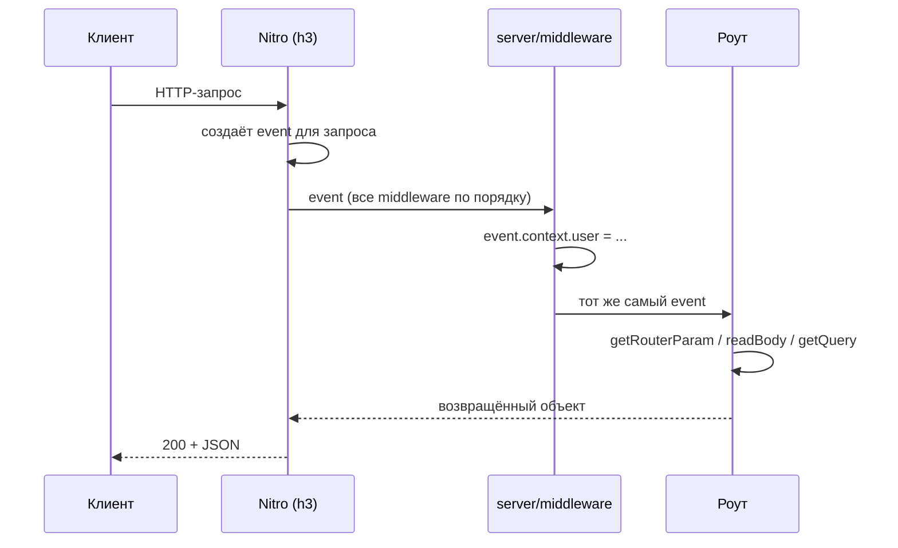

# Урок 02. Event — это весь запрос

> **Идея в трёх строках**
> - Обработчик получает один объект `event`, и в нём лежит вообще всё: сырой Node-запрос, ответ, параметры маршрута и ваш собственный контекст.
> - Все хелперы h3 (`readBody`, `getQuery`, `getRouterParam`, `setResponseStatus`, `getRequestURL`) — это функции от `event`, а не отдельный API.
> - `event.context` — единственное правильное место для «текущего пользователя» на время запроса.

**Зачем это.** Пока `event` выглядит как необязательный первый аргумент, бэкенд
остаётся набором рецептов: тут `readBody`, тут `getQuery`. Как только вы видите, что
это один объект на весь запрос, становятся объяснимыми и middleware, и запрет на
двойное чтение тела, и то, почему в серверном коде нельзя позвать `useState`.

## Что в нём лежит

| Часть | Что это | Как читать |
| --- | --- | --- |
| `event.node.req` | `IncomingMessage` из Node | напрямую, если нужен поток или сырые заголовки |
| `event.node.res` | `ServerResponse` из Node | только если правда нужен ручной ответ |
| `event.context` | пустой объект, ваш на время запроса | `event.context.user = ...` |
| маршрут | параметры из имени файла | `getRouterParam(event, 'id')` |
| тело | JSON или form-data | `readBody(event)` |
| query | строка запроса | `getQuery(event)` |
| всё остальное | URL, cookie, заголовки | `getRequestURL`, `parseCookies`, `getHeader` |

Правило, которое стоит запомнить: **`event.node.res` — это выход из системы**.
Ответили через него вручную (`end()`) — Nitro больше не знает, что вы вернули, и
типизация роута на клиенте пропадает. Оставьте ручной ответ тем случаям, где нужен
стриминг или SSE.

## Маршрут — это имя файла

Nitro строит роутинг из структуры папок, и это важнее, чем кажется: имя файла — часть
контракта API.

```bash
server/
├── api/
│   └── users/
│       ├── index.get.ts    # GET  /api/users
│       ├── index.post.ts   # POST /api/users
│       └── [id].get.ts     # GET  /api/users/:id
├── routes/
│   └── health.ts           # GET  /health   (без префикса /api)
└── middleware/
    └── auth.ts             # на каждый запрос, до всех роутов
```

Три следствия, о которые спотыкаются:

- **`api/` даёт префикс `/api`, `routes/` не даёт.** Второе нужно для вещей, которые
  не API по смыслу: health-check, вебхук платёжки, sitemap.
- **Метод задаётся суффиксом** (`.get`, `.post`, `.put`, `.delete`). Файл без
  суффикса отвечает на любой метод. Если есть `test.get.ts` и `test.post.ts`, то
  `PUT /test` вернёт 405, и это правильно.
- **Динамические роуты ограничены.** Сегменты в скобках из имени файла работают, но
  полной функциональности роутов страниц (опциональные сегменты, вложенные параметры)
  здесь нет. Для «поймать всё» есть catch-all: `api/foo/[...slug].ts`.

## `event.context` — канал между middleware и обработчиком

Серверный middleware не возвращает значение: он либо дополняет `event`, либо бросает
ошибку. Всё, что он положил в `event.context`, видят все последующие обработчики
этого запроса.



```ts
// server/middleware/auth.ts
export default defineEventHandler(async (event) => {
  const token = getCookie(event, 'session')
  // findUserBySession — ваш код; здесь важен только результат
  event.context.user = token ? await findUserBySession(token) : null
  // ничего не возвращаем и не отвечаем
})
```

```ts
// server/api/me.get.ts
export default defineEventHandler((event) => {
  const user = event.context.user

  if (!user) {
    throw createError({ status: 401, statusText: 'Unauthorized' })
  }

  return { id: user.id, name: user.name }
})
```

`event.context` в TypeScript по умолчанию пустой, и `event.context.user` будет
ошибкой типов. Расширяется он объявлением модуля, и это место стоит держать в
`server/types/`, чтобы типы контекста были в одном месте, а не дублировались в
каждом обработчике:

```ts
// server/types/h3.d.ts
declare module 'h3' {
  interface H3EventContext {
    user?: { id: string; name: string } | null
  }
}

export {}
```

Точные имена интерфейса и модуля для расширения зависят от версии h3, которая
приехала с вашим Nuxt: в h3 первой линии это `H3EventContext` из пакета `h3`.
Если типы не подхватываются, сверьтесь с `node_modules/h3/dist/index.d.ts` в своём
проекте — там интерфейс контекста объявлен, и расширять нужно именно его.

## Почему тело читается один раз

`readBody` потребляет поток запроса. Практически это значит две вещи:

1. **Дважды прочитать тело не получится.** Если нужен и сырой вид, и разобранный
   объект, читайте один раз и передавайте дальше результат.
2. **Тело есть не у всех методов.** Вызов `readBody` в GET-обработчике бросает
   ошибку 405 Method Not Allowed. Отсюда привычка называть файлы `.post.ts` там, где
   читается тело: это не декорация, это защита от неверного вызова.

Та же логика у query и параметров: `getQuery(event)` возвращает `string | string[]`
для каждого ключа, потому что HTTP ничего не знает о ваших типах. Приведение типов
здесь — не формальность, а место, где живут баги (см. урок про валидацию).

## Где ломается

**1. Middleware возвращает значение.**

Middleware должен только смотреть, дополнять или бросать. Возвращённый объект
становится ответом запроса, и роут до него уже не дойдёт. Симптом: эндпоинт внезапно
отдаёт JSON из middleware вместо своих данных.

**2. В серверном коде зовут composable приложения.**

```ts
// server/api/foo.ts
export default defineEventHandler(() => {
  const user = useUser() // ❌ это из app/
})
```

Ни `useUser`, ни `useState`, ни `useRoute` в Nitro не существует: там нет Nuxt-приложения,
а есть `event`. Серверный аналог «состояния на время запроса» — это `event.context`.

**3. Тип ответа потеряли ручным ответом.**

Как только обработчик пишет в `event.node.res.end()`, Nitro перестаёт генерировать тип
роута, и на клиенте `useFetch('/api/foo')` получает `unknown`. Тихо, без ошибки — просто
пропадает автодополнение, и через месяц в компонент приезжает поле, которого нет.

## Как это в проекте практики

`server/middleware/auth.ts` кладёт сессию в `event.context.session` и `event.context.user`,
а обработчики её оттуда не читают: `server/utils/requireRole.ts` берёт пользователя через
`requireUserSession(event)`. Канал тот же, просто спрятан в хелпер — `event.context`
остаётся единственным местом, где middleware и обработчик встречаются.

## Попробуй · Quick Win · 10 мин

1. Создайте `server/middleware/trace.ts`, который кладёт в контекст время старта:

   ```ts
   export default defineEventHandler((event) => {
     event.context.startedAt = Date.now()
   })
   ```

2. Объявите тип контекста в `server/types/h3.d.ts` (пример выше) и добавьте поле
   `startedAt: number`.

3. В любом существующем роуте верните `{ ms: Date.now() - event.context.startedAt }`.
   Убедитесь, что типы не ругаются, а middleware реально успевает выполниться раньше.

4. Сломайте намеренно: вызовите `readBody(event)` в GET-роуте и посмотрите на 405.
   Это дешевле, чем узнать о таком поведении в проде.

## Правило в playbook

> Все данные запроса берутся из `event` хелперами, а «текущее» состояние запроса
> живёт в `event.context`, а не в модульной переменной.

## Источники

- https://nuxt.com/docs/4.x/directory-structure/server
- https://nuxt.com/docs/4.x/guide/concepts/server-engine
