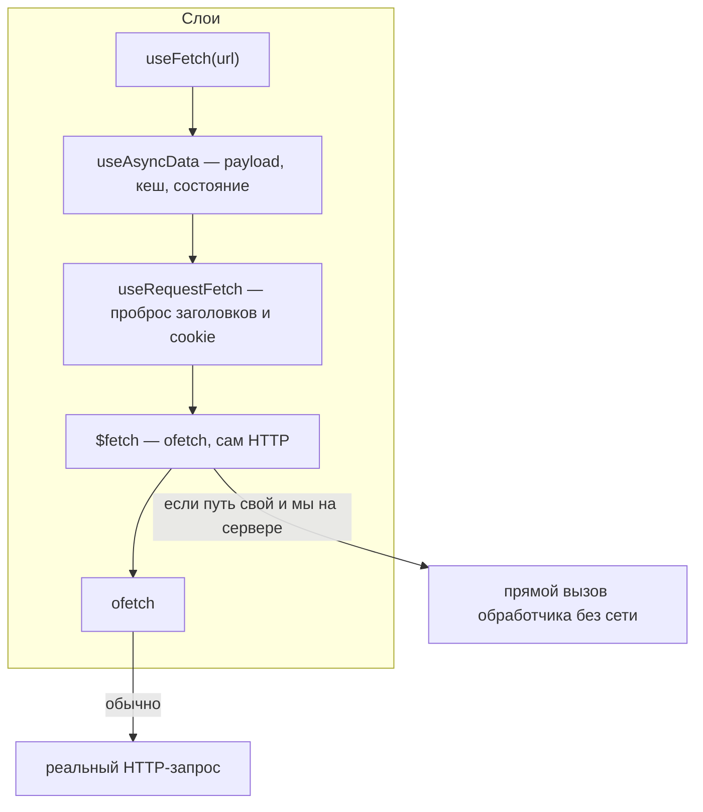

# Урок 03. `$fetch` и `useFetch` — разные вещи

> **Идея в трёх строках**
> - `$fetch` — это HTTP-клиент (ofetch). На сервере вызов своего же роута через него не идёт по сети: Nitro вызывает функцию напрямую.
> - `useFetch` — обёртка над `useAsyncData`, которая под капотом берёт `useRequestFetch`, поэтому при SSR заголовки и cookie запроса доезжают до вашего API.
> - Разница не в удобстве, а в том, кто отвечает за кеш, состояние и проброс контекста.

**Зачем это.** Классический баг «в браузере всё работает, на первом рендере
401» — это ровно путаница между этими двумя функциями. Второй по частоте —
«почему запрос ушёл дважды».

## Кто кого оборачивает



Из этой схемы вытекают все практические свойства, дальше — только следствия.

**Прямой вызов.** Nitro разрешает `$fetch` на свой же роут без сети: на сервере
вызов уходит прямо в функцию обработчика. Экономия запроса приятна, но у неё есть
цена — такой вызов не проходит через HTTP-слой, и часть вещей (заголовки, cookie
входящего запроса) сама по себе не появится.

**Проброс контекста.** На клиенте браузер прикладывает cookie сам. При SSR запрос
делает сервер, и по соображениям безопасности заголовки входящего запроса нужно
пробросить руками. Это делает `useRequestFetch`, и `useFetch` использует его
автоматически. Заголовки, которые не пробрасываются намеренно: `transfer-encoding`,
`connection`, `keep-alive`, `upgrade`, `expect`, `host`, `accept`.

## Ключевое различие на практике

| Ситуация | Что брать |
| --- | --- |
| Данные для первого рендера страницы | `useFetch` / `useAsyncData` |
| Внутри обработчика или Nitro-плагина | `$fetch` |
| По кнопке, после мутации, в императивном коде | `$fetch` |
| Нужен `status`, `error`, `refresh`, шаринг с другими компонентами | `useFetch` |
| Нужен полный контроль над заголовками и URL | `$fetch` внутри `useAsyncData` + `useRequestFetch` |

Правило пары строк: `useFetch` — для **данных страницы**, `$fetch` — для **действий
и серверного кода**. Смешивать их в одном месте почти всегда означает, что вы
случайно выбрали не тот слой.

## `await` и `lazy`: что именно меняется

`useFetch` можно не ждать: на сервере Nuxt всё равно дождётся промиса перед отрисовкой,
и в HTML данные уже будут. Разница в том, что происходит дальше:

- **с `await`** исполнение в `<script setup>` останавливается, `data` уже заполнена,
  но клиентская навигация на эту страницу блокируется до готовности данных;
- **без `await`** код продолжает исполняться, `data` начинается с дефолта, а
  состояния загрузки и ошибки вы разбираете сами через `status` и `error`;
- **`lazy: true`** делает то же самое явно: навигация не блокируется.

`status` принимает четыре значения: `idle`, `pending`, `success`, `error`. Если вы
не ждёте результат, забудете про `pending` — получите мигание пустого экрана на
медленной сети.

## Один URL, несколько компонентов

Автоматический ключ `useFetch` уникален для **места вызова**. Поэтому два разных
компонента, дергающие `/api/random`, сделают два запроса, а два экземпляра одного
и того же компонента — один. Чтобы состояние шарилось осознанно, задайте `key`:

```vue
<!-- app/components/TotalA.vue -->
<script setup lang="ts">
const { data: total } = await useFetch('/api/cart/total', { key: 'cart-total' })
</script>
```

```vue
<!-- app/components/TotalB.vue -->
<script setup lang="ts">
const { data: total } = await useFetch('/api/cart/total', { key: 'cart-total' })
// тот же key → один запрос, общие data/error/status
</script>
```

Извлечь эти данные из другого места можно через `useNuxtData('cart-total')`.

Отдельная ловушка рядом: реактивные параметры. `useFetch` с `query: { q: searchQuery }`
сам перезапросит при изменении ref. Это удобно и неожиданно: если `watch` не нужен,
его выключают (`watch: false`), иначе один ввод в поле поиска даёт запрос на каждую
букву.

## Где ломается

**1. `$fetch` вместо `useRequestFetch` при SSR.**

```vue
<script setup lang="ts">
// ❌ cookie не проброшены: обработчик увидит пустой запрос
const { data } = await useAsyncData(() => $fetch('/api/cookies'))
</script>
```

В браузере этот код работает и создаёт ощущение, что проблема в сервере. Лечение:

```ts
const requestFetch = useRequestFetch()
const { data } = await useAsyncData(() => requestFetch('/api/cookies'))
```

**2. `server: false` и `await`.**

Если запрос отключён на сервере, данные появятся только после гидратации. Даже с
`await` внутри `<script setup>` `data` останется `undefined` при первом рендере.
Это не баг, это определение опции.

**3. `useFetch` не из Nuxt.**

Предупреждение в доке: если в компоненте есть `import { useFetch } from '@vueuse/core'`,
`data` приедет строкой вместо разобранного JSON. Симптом абсурдный, причина скучная —
конфликт автоимпорта и явного импорта.

**4. Свой `useFetch` назвали `useFetch`.**

Имя занято компилятором Nuxt. Для обёртки с дефолтами есть `createUseFetch`
(например, свой клиент с `baseURL` и заголовком авторизации).

## Попробуй · Deep Focus · 15 мин

1. Создайте роут, который показывает, что до него дошло:

   ```ts
   // server/api/cookies.ts
   export default defineEventHandler((event) => {
     return { cookies: parseCookies(event) }
   })
   ```

2. На странице сравните два варианта и выведите оба результата:

   ```vue
   <script setup lang="ts">
   const requestFetch = useRequestFetch()
   const { data: forwarded } = await useAsyncData(() => requestFetch('/api/cookies'))
   const { data: notForwarded } = await useAsyncData(() => $fetch('/api/cookies'))
   </script>
   ```

3. Откройте страницу с какой-нибудь cookie в браузере. Первый вариант вернёт её,
   второй — пустой объект. Это и есть вся разница между `useFetch` и `$fetch` на
   сервере, увиденная своими глазами.

4. Усложнение: поменяйте `useAsyncData` без `await` на `await` и посмотрите, как
   изменится порядок отрисовки в network-панели.

## Правило в playbook

> Данные для рендера — через `useFetch`/`useAsyncData` (они пробрасывают контекст),
> `$fetch` — для действий и серверного кода; при SSR-вызове своего API вручную
> сначала берём `useRequestFetch`.

## Источники

- https://nuxt.com/docs/4.x/api/composables/use-fetch
- https://nuxt.com/docs/4.x/api/composables/use-request-fetch
- https://nuxt.com/docs/4.x/guide/concepts/server-engine
