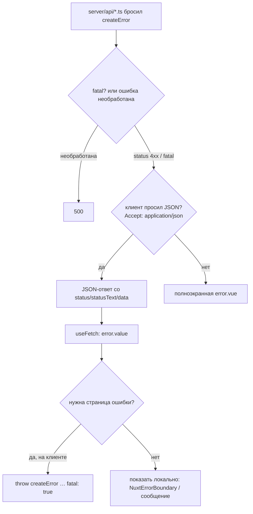

# Урок 04. Ошибка — часть контракта

> **Идея в трёх строках**
> - В API-роуте бросаем `createError({ status, statusText, data })`: до клиента доезжают статус, короткий `statusText` и `data`.
> - `message` из серверного обработчика на клиент не приходит. Это не баг, а защита от утечки внутренностей.
> - `useFetch` никогда не бросает: он отдаёт ошибку в `error`, а полноэкранную страницу вы включаете сами через `fatal: true` или `createError` в `setup`.

**Зачем это.** Пока сервер отвечает «500 на всё», клиент не может отличить «такой
записи нет» от «база недоступна», и интерфейс вынужден врать пользователю. Разделение
статусов и машиночитаемого `data` — это и есть контракт ошибки.

## Как ошибка проходит через стек



Три уровня, на которых ошибку ловят, и путать их дорого:

1. **Сервер** формирует ошибку и её статус.
2. **Клиентский `useFetch`** складывает её в `error` и продолжает рендер.
3. **Vue-слой** либо показывает ошибку локально (`NuxtErrorBoundary`), либо
   роняет приложение на полноэкранную `error.vue`.

## Что именно долетает до клиента

```ts
// server/api/invoices/[id].get.ts
export default defineEventHandler(async (event) => {
  const id = getRouterParam(event, 'id')

  if (!id) {
    throw createError({
      status: 400,
      statusText: 'Missing invoice id',
      data: { field: 'id' },
    })
  }

  const invoice = await loadInvoice(id) // ваш код

  if (!invoice) {
    throw createError({
      status: 404,
      statusText: 'Invoice not found',
      data: { id },
    })
  }

  return invoice
})
```

- `status` — HTTP-статус, по нему клиент ветвится.
- `statusText` — короткая HTTP-совместимая строка, только ASCII. Именно её видит клиент.
- `data` — машиночитаемые подробности. У `useFetch` они доступны как
  `error.value.data.data` (да, дважды: внешний `data` — поле ошибки useFetch, внутренний —
  ваше значение).
- `message` — для серверных логов и разработки. Для клиента его заменяет `statusText`.
- `cause` — оригинальная ошибка, которую вы оборачиваете. В проде цепочка причин в
  ответ и на страницу ошибки не попадает, в разработке видна.

Отдельная деталь ради безопасности: в `statusText` и `data` не стоит класть сырой
ввод пользователя. Дока прямо предупреждает об этом в разделе про API-роуты.

## `status` или `statusCode`

Документация Nuxt 4 описывает поля `status` и `statusText`. В коде, написанном на
Nuxt 3-эпоху, вы почти наверняка встретите `statusCode` и `statusMessage`. Это не
разные функции, а разные поколения API h3 под ними. Практический вывод: в новом коде
пишите так, как в документации вашей версии, а при чтении чужого кода сверяйтесь с
версией h3 в `package.json`, прежде чем «чинить» то, что не сломано.

## Страница ошибки — это отдельная загрузка

`error.vue` в корне приложения переопределяет полноэкранную ошибку. Неочевидное
следствие: **рендер страницы ошибки — полностью новая загрузка**, и middleware
прогоняются заново. Поэтому в middleware иногда смотрят `useError()`, чтобы не
упасть второй раз на том же месте.

`clearError({ redirect: '/' })` убирает ошибку и уводит на безопасную страницу.
Типичная ошибка новичка: поймать ошибку, показать её и не вызвать `clearError` —
приложение остаётся в состоянии ошибки, и дальше странно ведёт себя вся навигация.

Важно и про плагины: если плагин упал, всё, что зависит от него (`$route`,
`useRouter`), не заработает, пока ошибку не сбросили.

## Где ломается

**1. `throw new Error('Нет такой записи')` в API.**

Любая необработанная ошибка сервера — это 500. Клиент не отличит её от падения базы,
а в разработке ещё и увидит текст, который в проде не должен показываться. Лечение:
`createError` с осмысленным статусом.

**2. Ждут `message` на клиенте.**

`message` из API-роута не пропагируется. Код вида
`toast(error.value.message)` покажет пустоту. Показывайте `statusText`, а детали
берите из `data`.

**3. `useFetch` считают бросающим.**

```ts
try {
  await useFetch('/api/thing')
} catch {
  // сюда не попадём: ошибка в error.value, промис не отклоняется
}
```

Отсюда два пути: проверять `error.value` или ронять страницу осознанно через
`throw createError({ status: 404, fatal: true })` в `setup`.

**4. Ошибку бросают в `useFetch`-колбэке и ждут 500.**

Хук `onResponseError`/`onRequestError` — это место для логирования и трансформации,
а не для «вернуть статус». Статус формирует сервер.

## Попробуй · Quick Win · 10 мин

1. Найдите в проекте роут, который на «не найдено» бросает обычный `new Error`
   (или возвращает `null` с кодом 200).

2. Замените на `createError` со `status: 404`, коротким `statusText` и `data`,
   в котором лежит идентификатор.

3. На клиенте выведите разницу:

   ```vue
   <script setup lang="ts">
   const { data, error } = await useFetch('/api/things/does-not-exist')
   // error.value?.statusCode или error.value?.status — сверьтесь с версией проекта
   // error.value?.data?.data — ваши детали из data
   </script>
   ```

4. Проверьте то же самое curl'ом с `Accept: application/json`: должен прийти JSON,
   а не HTML страницы ошибки. Это и есть разница между «ошибка API» и «ошибка страницы».

## Правило в playbook

> Сервер сообщает об ошибке статусом и машиночитаемым `data`, а не текстом `message`;
> клиент ветвится по статусу и никогда не ждёт сообщения с сервера.

## Источники

- https://nuxt.com/docs/4.x/api/utils/create-error
- https://nuxt.com/docs/4.x/getting-started/error-handling
- https://nuxt.com/docs/4.x/api/composables/use-fetch
