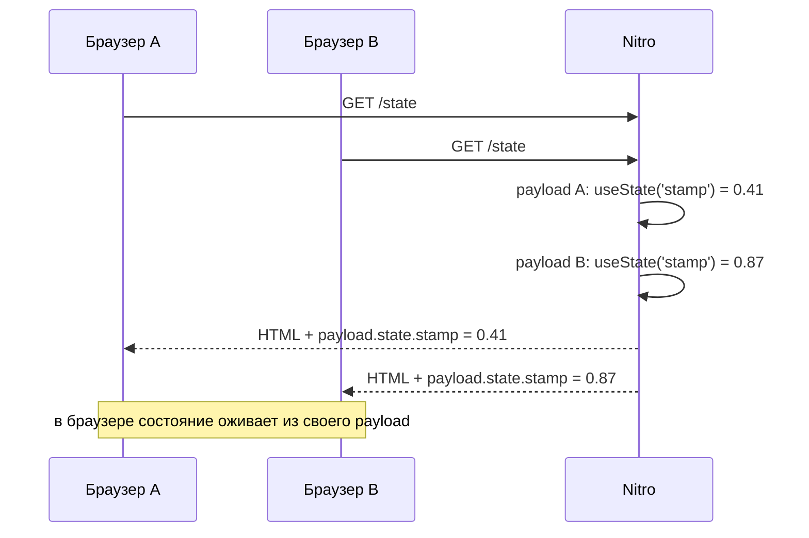
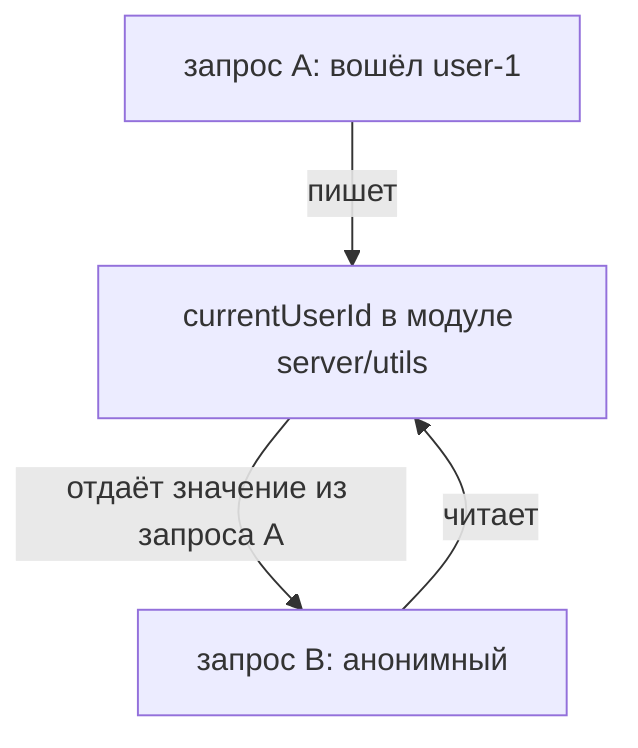

# Урок 05. Состояние: сервер против клиента

> **Идея в трёх строках**
> - `useState` привязан не к приложению, а к конкретному запросу: значение уходит в `payload.state` этого ответа и в браузере оживает только из него.
> - Модульная переменная (`let currentUser` в серверном файле, `export const user = ref()` в `app/`) живёт столько же, сколько процесс, и именно так состояние одного пользователя оказывается у другого.
> - Pinia на SSR попадает в тот же скоуп «один запрос», поэтому «текущего пользователя» держать в ней неудобно — у этого значения есть серверный источник истины.

**Зачем это.** Тема выглядит как повторение стейт-менеджмента, а на деле это самая частая утечка в fullstack-приложении на Nuxt — кто-то вынес `ref` из `setup`, и в проде анонимный посетитель на секунду видит чужой профиль. Ниже три места, где живёт состояние, и разница между ними, после которой такие баги перестают быть загадкой.

## Payload конкретного запроса

На клиенте `useState('user')` неотличим от обычного `ref`. На сервере он работает иначе — значение складывается в `nuxtApp.payload.state`, а payload сериализуется в HTML того самого ответа. Дока `useNuxtApp` перечисляет ключи payload (`serverRendered`, `data`, `state`) и прямо говорит, что в `state` попадают данные `useState`.

Отсюда простой тест на понимание: два SSR-запроса идут параллельно, каждый создаёт свой payload, каждый возвращает своё значение. Общего словаря между ними нет — словарь живёт в объекте ответа, а не в модуле.



Ключ в сигнатуре `useState<T>(key, init)` документирован как уникальный ключ, который обеспечивает дедупликацию, то есть адресует запись внутри запроса — а не глобальную переменную с таким именем. Практический вывод: значение, собранное на сервере, кладётся в `useState` в том же запросе, где оно нужно, а не «где-то при старте приложения».

Вторая сторона той же модели: payload сериализуется в JSON, поэтому в `useState` не место классам, функциям и символам. Дока `useState` предупреждает об этом отдельным блоком, а в разделе про ошибки приводит текст `Cannot stringify arbitrary non-POJOs` для случая с экземпляром класса. Для нестандартных типов есть `definePayloadPlugin` со своим сериализатором и десериализатором, но это уже осознанное расширение формата, а не способ пронести в состояние что попало.

## Модульная переменная: короткий путь к утечке

```ts
// app/composables/user.ts
export const currentUser = ref<User | null>(null) // ❌ модульный ref
```

Дока Nuxt по управлению состоянием предупреждает об этом буквально: `const state = ref()` вне `<script setup>` или `setup()` даёт состояние, общее для всех запросов на сервере, и приводит к утечкам памяти. Там же рекомендация — `const useX = () => useState('x')`.

В `server/` тот же паттерн выглядит безобиднее, а бьёт сильнее:

```ts
// server/utils/session-state.ts
let currentUserId: string | null = null // ❌ живёт столько же, сколько процесс

export function setCurrentUserId (id: string) { currentUserId = id }
export function getCurrentUserId () { return currentUserId }
```

Модуль в Nitro не пересоздаётся на запрос — плагины исполняются один раз при старте сервера, дальше модульная переменная просто лежит в памяти процесса. Значит все запросы, попавшие в этот процесс, читают и пишут одно и то же поле.



В dev это почти не видно — запросы редкие, между ними успевает пройти перезагрузка модуля. В проде на long-running сервере достаточно двух одновременных пользователей.

## Pinia на SSR и где держать текущего пользователя

Pinia в Nuxt живёт через модуль `@pinia/nuxt`. Документация Pinia для Nuxt говорит, что о сериализации и XSS заботиться не нужно — Nuxt сам встраивает состояние в HTML и поднимает его на клиенте. Инициализацию на сервере там же предлагают делать через `callOnce`, и этот же приём показан в Nuxt-доке по управлению состоянием.

Что это значит для модели: store на сервере создаётся внутри Nuxt-приложения текущего запроса, то есть скоуп у него тот же, что у `useState`. Разница в другом: store — это удобный кеш для UI, а не место, где хранится истина о том, кто пришёл. Если положить туда пользователя, придётся отвечать на вопросы «когда он заполняется», «что будет, если запрос пришёл до заполнения», «почему после перехода на другую страницу он пустой».

Рабочая схема на три шага:

1. сервер читает сессию из httpOnly cookie и знает пользователя;
2. в этом же запросе значение кладётся в `useState` (или в то, что модуль Pinia даёт как начальное состояние);
3. клиент получает готовое значение в payload и не делает отдельный запрос за юзером после гидрации.

Кода для шага 1 здесь нет: это тема урока 08. Важен порядок: сначала серверный факт, потом per-request состояние, потом UI.

## Где ломается

**1. `useState` в серверном роуте.**

```ts
// server/api/me.get.ts
export default defineEventHandler(() => {
  const user = useState('user') // ❌ Nuxt-контекста здесь нет
  return user.value
})
```

Дока `useNuxtApp` оговаривает область: контекст доступен на клиенте и на сервере, «но не внутри Nitro-роутов». Симптом: ошибка про недоступный Nuxt instance. Лечение не «обойти проверку», а развести слои: в Nitro состояние запроса — это `event.context` и данные, которые обработчик вернул.

**2. Модульная переменная под видом кеша.**

`let cache = null` в `server/utils` выглядит как оптимизация — а ведёт себя как глобальная переменная процесса. Симптом: пользователь видит чужие данные после того, как вошёл кто-то другой, причём только под нагрузкой. Если это действительно кеш, у него есть ключ (id пользователя, url, параметры), и живёт он в `useStorage` или в кеше Nitro, а не в модуле без ключа.

**3. `useState` без ключа в переиспользуемом компоненте.**

Сигнатура допускает вызов без ключа, и тогда ключ строится из файла и номера строки вызова. Два экземпляра одного компонента на странице получат одно и то же состояние, и это редко то, что имелось в виду. Симптом: правка в одной карточке меняет вторую.

## Попробуй · Deep Focus · 15 мин

1. Сделайте страницу, которая печатает состояние, созданное на сервере:

   ```vue
   <!-- app/pages/state.vue -->
   <script setup lang="ts">
   const stamp = useState('stamp', () => Math.random())
   </script>

   <template>
     <pre>{{ stamp }}</pre>
   </template>
   ```

2. Запросите её дважды подряд и сравните payload в HTML:

   ```bash
   curl -s localhost:3000/state | grep -o '"stamp":[0-9.]*'
   curl -s localhost:3000/state | grep -o '"stamp":[0-9.]*'
   ```

   Числа разные, утечки нет.

3. Сломайте её модульной переменной и повторите замер:

   ```ts
   // app/utils/stamp.ts
   export const sharedStamp = Math.random() // ❌ один раз на процесс
   ```

   Теперь `useState('stamp', () => sharedStamp)` вернёт одно и то же число во всех ответах до перезапуска сервера. Это и есть утечка между запросами, увиденная своими глазами.

4. Верните инициализатор внутри `useState` и оставьте рядом с ключом комментарий: чьё это состояние и сколько оно живёт.

## Правило в playbook

> Состояние, привязанное к пользователю, живёт в payload его запроса; в модуле остаётся только то, что одинаково для всех.

## Источники

- https://nuxt.com/docs/4.x/getting-started/state-management
- https://nuxt.com/docs/4.x/api/composables/use-nuxt-app
- https://pinia.vuejs.org/ssr/nuxt.html

<!-- проверить: в сигнатуре useState ключ описан как "unique key ensuring that data fetching is properly de-duplicated across requests"; в уроке он намеренно прочитан как адрес записи внутри запроса, а не как межзапросный кеш -->
<!-- проверить: @pinia/nuxt кладёт состояние стора в payload сам; дока Pinia утверждает только, что сериализацией и XSS занимается Nuxt, конкретный ключ payload не назван -->
<!-- проверить: точный текст ошибки при useState в Nitro-роуте не проверялся, в уроке он назван описательно ("ошибка про недоступный Nuxt instance") -->
