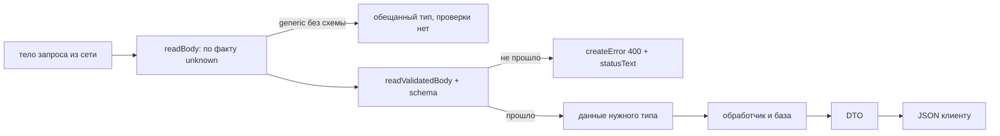

# Урок 06. Валидация на границе

> **Идея в трёх строках**
> - Тело запроса приходит как `unknown`, а `readBody<MyType>()` ничего не проверяет — generic это обещание, а не валидатор.
> - `readValidatedBody`, `getValidatedQuery` и `getValidatedRouterParams` принимают схему (zod, valibot, любой Standard-Schema) и возвращают тип, который совпадает с реальностью.
> - Наружу уходит DTO, а не строка из базы, и ошибка уходит как 400 со `statusText`, который клиент умеет прочитать.

**Зачем это.** Пока в проекте один GET-роут, граница ввода не видна. С первым POST начинается всё сразу: клиент присылает не то, обработчик падает на `undefined`, в ответ летит 500, и по логам непонятно, кто виноват. Валидация на границе решает две задачи одной строкой — превращает `unknown` в проверенный тип и делает отказ частью контракта.

## Generic это не проверка

Соблазн выглядит так:

```ts
// server/api/posts.post.ts
export default defineEventHandler(async (event) => {
  const body = await readBody<{ title: string }>(event) // ❌ generic это обещание
  return { title: body.title.trim() }
})
```

Дока h3 предупреждает отдельным блоком: generic-параметр это не валидация, интерфейс, переданный в `readBody`, проверкой не является. Присланный `{"title": 42}` успешно пройдёт через generic — тип пообещали, данные не проверили. Дальше обработчик падает на вызове `.trim()`, до клиента доходит 500, а в логах сообщение про `trim`, которое ничего не объясняет про входные данные.

`unknown` в этой истории честнее — он заставляет написать проверку до первого обращения к полю.

## Схема на входе

`readValidatedBody` устроен как `readBody` плюс валидатор. Вторым аргументом идёт либо функция, либо схема Standard-Schema совместимой библиотеки (zod, valibot, arktype). На выходе — объект уже нужного типа, и TypeScript видит его без приведения.

```ts
// server/api/posts.post.ts
import { z } from 'zod'

const createPostSchema = z.object({
  title: z.string().min(1).max(120),
  tags: z.array(z.string()).max(5).default([]),
})

export default defineEventHandler(async (event) => {
  const body = await readValidatedBody(event, createPostSchema)
  // body: { title: string, tags: string[] }

  return { title: body.title, tags: body.tags }
})
```

Важное свойство схемы: она не только отсекает мусор, но и приводит данные к типу. В доке h3 это показано на query, где строки `page` и `size` превращаются в числа регуляркой плюс `transform`. Тот же приём:

```ts
// server/api/posts/search.get.ts
import { z } from 'zod'

const pageNumber = z.string().regex(/^\d+$/).transform(Number)

const listQuerySchema = z.object({
  page: pageNumber.default(1),
  q: z.string().optional(),
})

export default defineEventHandler(async (event) => {
  const query = await getValidatedQuery(event, listQuerySchema)
  return listPosts(query.page) // query.page: number
})
```

Для параметров маршрута есть `getValidatedRouterParams`. Он нужен там, где `getRouterParam` вернул строку, а обработчику нужен uuid или число:

```ts
// server/api/posts/[id].get.ts
import { z } from 'zod'

const paramsSchema = z.object({ id: z.string().uuid() })

export default defineEventHandler(async (event) => {
  const { id } = await getValidatedRouterParams(event, paramsSchema)
  return findPost(id)
})
```

По доке h3 отказ валидации превращается в ошибку `400 Validation Error`, а в её `data` лежат детали проверки, пригодные для показа клиенту. Если нужен свой `statusText`, схему можно применить вручную — `createPostSchema.safeParse(await readBody(event))` и дальше `createError` со своим текстом и `data`. Дока h3 показывает этот приём для всех трёх хелперов.

Почему это не дублирует проверку в форме на клиенте: клиентская схема нужна для пользователя, чтобы он увидел ошибку до отправки, а серверная — для сервера, потому что `curl` не знает про форму. Две схемы могут быть похожи, но живут они в разных бандлах, и вторая не отменяется первой.

Итоговая форма границы:



## DTO на выходе

Строка из базы и контракт API — это разные вещи. У строки есть `password_hash`, `internal_flags`, `deleted_at` и любое поле, которое добавит следующая миграция. Всё, что обработчик вернул, уезжает клиенту целиком.

```ts
// shared/types/post.ts
export interface PostDto {
  id: string
  title: string
  createdAt: string
}
```

```ts
// server/api/posts.get.ts
export default defineEventHandler(async (): Promise<PostDto[]> => {
  const rows = await repository.list()

  return rows.map((row) => ({
    id: row.id,
    title: row.title,
    createdAt: row.created_at.toISOString(),
  }))
})
```

DTO в `shared/types` ещё и работает как контракт для клиента — тип в `useFetch` приезжает из обработчика, как в уроке 01, и появляется без ручного объявления. Обратная сторона тоже приятная: пока маппинг явный, новое поле в таблице не протекает в ответ само.

## 400 и `statusText` как контракт

Дока `createError` для API-роутов говорит конкретно: короткий `statusText` доступен на клиенте, а `message` до клиента не доезжает. Поэтому различать случаи нужно статусом и `statusText`, а подробности складывать в `data` (на клиенте они окажутся в `error.value.data.data`).

```ts
// server/api/posts/[id].delete.ts
import { z } from 'zod'

export default defineEventHandler(async (event) => {
  const { id } = await getValidatedRouterParams(event, z.object({ id: z.string().uuid() }))
  const post = await findPost(id)

  if (!post) {
    throw createError({ status: 404, statusText: 'Post not found' })
  }
  if (post.authorId !== event.context.auth?.userId) {
    throw createError({ status: 403, statusText: 'Not the author' })
  }

  await removePost(id)
  setResponseStatus(event, 204)
})
```

Раскладка, которая окупается на клиенте: 400 — неверный ввод, 401 — нет сессии, 403 — нет прав, 404 — нет объекта, 409 — конфликт версий. Пять разных исходов вместо одного 500 дают пять разных экранов без чтения логов.

## Где ломается

**1. `readBody` в GET-роуте.**

Дока Nuxt оговаривает: при вызове в GET `readBody` бросит `405 Method Not Allowed`. Симптом виден сразу в браузере при открытии адреса. Причина обычно в том, что данные пришли в query, а обработчик писался по привычке из POST.

**2. Сущность из базы прямо в ответе.**

```ts
// server/api/users/[id].get.ts
export default defineEventHandler(async (event) => {
  const id = getRouterParam(event, 'id')
  return findUser(id) // ❌ вернулось всё, что есть в таблице
})
```

Симптом: в JSON видно `passwordHash` и служебные поля. Ошибка не ловится типами, потому что тип у функции честный, он просто шире контракта. Лечится маппером, а не «вырезанием одного поля».

**3. Отказ без объяснения.**

```ts
// server/api/posts.post.ts
if (!body.title) {
  throw createError({ status: 400, message: 'bad request' }) // ❌ message не доедет
}
```

Симптом: клиент получает 400 и ни строчки причины, потому что `message` из API-роута не пробрасывается. Всё, что клиент увидит, — это статус и `statusText`.

## Попробуй · Deep Focus · 15 мин

1. Добавьте схему к одному POST-роуту через `readValidatedBody` и уберите generic из `readBody`.
2. Отправьте неверное тело и посмотрите ответ целиком:

   ```bash
   curl -i -X POST localhost:3000/api/posts \
     -H 'content-type: application/json' \
     -d '{"title":""}'
   ```

   Ожидаемо: 400 и в теле — детали проверки. Если вместо этого 500, значит схема не подключилась и данные ушли в обработчик как есть.

3. Отправьте верное тело и сравните: 200 и в ответе ровно те поля, что объявлены в DTO.
4. Замените автогенерируемый отказ на свой `createError` с `statusText` и `data`, и проверьте на клиенте, что `error.value.data.data` читается.

## Правило в playbook

> На границе сервера данные проходят схему, а не generic; наружу уходит объявленный DTO, а отказ приходит со статусом и `statusText`.

## Источники

- https://nuxt.com/docs/4.x/directory-structure/server
- https://github.com/h3js/h3/blob/main/docs/4.examples/validate-data.md
- https://nuxt.com/docs/4.x/api/utils/create-error

**О версии.** Ссылка на пример h3 ведёт в ветку `main`, а это h3 v2; в Nuxt 4 приезжает h3 v1. Имена `readValidatedBody`, `getValidatedQuery` и `getValidatedRouterParams` есть в обеих версиях, а форма ошибки валидации и её формулировки могут отличаться, поэтому сверяйтесь с версией `h3` в `package.json` своего проекта.

<!-- проверить: в схеме "не прошло -> createError 400" описан результат чтения хелперов h3; в вашей версии h3 текст и форма data ошибки валидации могут отличаться, свой statusText надёжнее -->
<!-- проверить: примеры h3 в docs/4.examples/validate-data.md написаны для ветки main (h3 v2); в Nuxt 4 сегодня приезжает h3 v1, где те же три хелпера есть, но это стоит сверить в lock-файле -->
