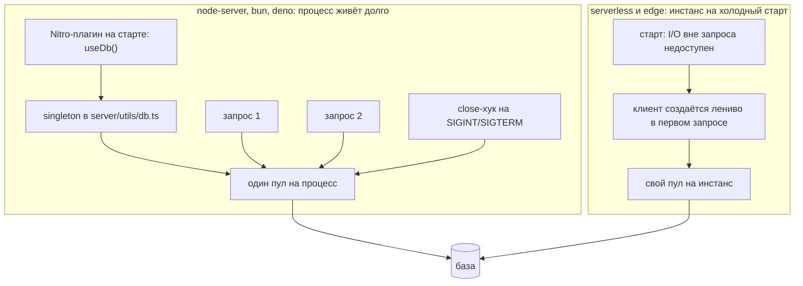

# Урок 07. База данных из Nitro

> **Идея в трёх строках**
> - Клиент базы — это ресурс процесса, а не запроса: он создаётся один раз и переиспользуется всеми запросами, попавшими в этот процесс.
> - Где его создавать, зависит от пресета: на long-running сервере можно прогреть пул в Nitro-плагине и закрыть в хуке `close`, на serverless и edge соединение открывается лениво, в первом запросе.
> - `event.context` — для того, что живёт ровно один запрос: пользователь, tenant, request id, иногда транзакция.

**Зачем это.** Подключение к базе обычно копируют из примера, а примеры бывают и для long-running сервера, и для edge-рантайма — и они несовместимы. В результате в проде кончаются соединения либо приложение падает на старте у хостера. Понимание того, кто и когда создаёт клиента, снимает оба сценария.

## Два разных жизненных цикла

Сначала факт из доки Nitro: плагины исполняются один раз при старте сервера, до первого запроса. И там же оговорка: на serverless и edge пресетах это происходит на каждом холодном старте. То есть модульная переменная живёт не «вечно», а «пока живёт инстанс» — и это очень разные вещи для node-сервера и для workers.

Второй факт оттуда же: некоторые платформы (док приводит в пример Cloudflare Workers) не разрешают I/O вне запроса, а плагины работают на старте. Отсюда рекомендация доки — на таких платформах соединение открывается лениво, при первом использовании.



Развилка простая: если процесс живёт, пул имеет смысл греть заранее и закрывать при остановке. Если процесс поднимается на запрос, греть нечего, а закрывать некому.

## Клиент в `server/utils` и прогрев в `server/plugins`

`server/utils` автоимпортируется в серверном контексте, поэтому это естественное место для клиента. Форма, работающая в обоих сценариях, одна — ленивый singleton.

```ts
// server/utils/db.ts
import { createDbClient, type DbClient } from './db-driver' // ← ваш драйвер: пул, ORM, libsql

let clientPromise: Promise<DbClient> | null = null

export function useDb (): Promise<DbClient> {
  // создаётся при первом вызове и переиспользуется до конца жизни процесса
  clientPromise ??= createDbClient(useRuntimeConfig().databaseUrl)
  return clientPromise
}

export async function closeDb (): Promise<void> {
  if (!clientPromise) return

  const client = await clientPromise
  await client.close() // у вашего драйвера метод закрытия может называться иначе
  clientPromise = null
}
```

Три вещи, которые здесь важны. Первая — `clientPromise`, а не `client`, иначе два одновременных запроса на старте создадут два пула. Вторая — `??=`, а не проверка на истинность, потому что промис всегда истинен. Третья — `useRuntimeConfig()` берёт строку подключения из конфига, то есть значение приходит из окружения (`NUXT_DATABASE_URL`), а не из кода; если конфиг зависит от запроса, `useRuntimeConfig(event)` точнее.

Строка подключения в `nuxt.config.ts` объявляется пустой, значение приходит на деплое:

```ts
// nuxt.config.ts
export default defineNuxtConfig({
  runtimeConfig: {
    databaseUrl: '', // NUXT_DATABASE_URL
  },
})
```

Всё, что относится к старту и остановке процесса, живёт в Nitro-плагине. Файлы из `server/plugins` Nuxt регистрирует как Nitro-плагины, и клиент из `server/utils` используется там как обычный автоимпорт.

```ts
// server/plugins/database.ts
export default defineNitroPlugin(async (nitroApp) => {
  await useDb() // ⚠️ I/O на старте: годится для node-server, не для workers

  nitroApp.hooks.hook('close', async () => {
    await closeDb()
  })
})
```

Хук `close` документирован как место для освобождения ресурсов. Тонкость, которую легко пропустить: на long-running пресетах он вызывается по `SIGINT` и `SIGTERM`, а на serverless и edge сигнала остановки нет, и хук сработает только если платформа сама закрывает рантайм. То есть на edge этот код не вреден, но и не обязателен.

Зачем вообще греть пул на старте: первая ошибка соединения тогда видна при деплое, а не в первом запросе живого пользователя. Если такой обмен не нравится, ленивый singleton без прогрева тоже рабочий вариант, просто первая ошибка приедет в первом запросе.

## `event.context` для одного запроса

Модульная переменная отвечает на вопрос «что общее для всего процесса». `event.context` — на вопрос «что относится к этому запросу»: дока Nuxt показывает это на примере middleware, который кладёт в контекст объект авторизации.

```ts
// server/middleware/request-context.ts
export default defineEventHandler(async (event) => {
  event.context.requestId = crypto.randomUUID()
  event.context.tenant = getTenantFromHost(getRequestHost(event))
})
```

Аккуратное правило разделения: клиент базы в контекст не кладём (он не per-request ресурс), а транзакцию можно, если её открывает middleware и закрывает обработчик. Пока транзакция нужна одному обработчику, проще передать её аргументом: `event.context` окупается там, где значение читают несколько слоёв, а цена ошибки — в том, что читатель не знает, кто и когда это поле заполнил.

## Где ломается

**1. Клиент создаётся в обработчике.**

```ts
// server/api/posts.get.ts
export default defineEventHandler(async () => {
  const db = await createDbClient(process.env.DATABASE_URL) // ❌ новый пул на запрос
  return db.query('select * from posts') // метод вашего драйвера
})
```

Симптом: под нагрузкой база отвечает отказом из-за превышения числа соединений, а время ответа растёт быстрее, чем нагрузка. Причина в том, что пул — это не «подключение», а набор соединений, и таких наборов становится столько же, сколько запросов.

**2. Прогрев на старте у платформы без long-running рантайма.**

Тот же плагин с `await useDb()` на workers упирается в ограничение платформы: I/O вне запроса там недоступен. Симптом: приложение падает или висит на холодном старте. Лечение описано в доке Nitro — соединение открывается лениво, при первом использовании, без `await` на верхнем уровне плагина.

**3. Клиент базы в `event.context`.**

Выглядит аккуратно («всё про запрос в контексте»), а фактически это пункт 1 с лишним слоем: каждый запрос получает свой пул. Побочный симптом заметен в тестах: раннер не завершается, потому что соединения никто не закрыл.

## Развилка: ORM или SQL

Выбор библиотеки в этом уроке не разбирается, но место для него теперь понятно: решение не про подключение, а про то, кто пишет запросы.

- **ORM** (Drizzle, Prisma): миграции и типы из коробки, цена — в том, что генерацию SQL и N+1 нужно контролировать отдельно.
- **SQL или query builder**: предсказуемые запросы и план, цена — в ручной работе и в собственных миграциях.
- **Встроенный слой Nitro**: `useDatabase()` на db0 с коннекторами к postgres, sqlite, d1 и другим, включается флагом `experimental.database` и в доке помечен как experimental. Для прототипа удобно, для прода стоит смотреть на статус эксперимента.

Критерий простой: если запросами занимается человек, который любит SQL, ORM будет мешать; если миграции и типы важнее плана запроса, ORM экономит недели.

## Как это в проекте практики

`server/utils/prisma.ts` создаёт один клиент на процесс: пул `pg` и Prisma 7 с driver
adapter живут в модуле, а в dev клиент дополнительно кладётся в `globalThis`, чтобы HMR
не плодил пулы. Обработчики клиент только импортируют. Postgres для dev поднимается
контейнером (`docker-compose.yml`, `pnpm db:up`), рядом — shadow-база для
`prisma migrate dev`.

## Попробуй · Deep Focus · 15 мин

1. Вынесите клиент в `server/utils/db.ts` в форме ленивого `clientPromise`, как выше.
2. Добавьте `server/plugins/database.ts` с прогревом и временным логом внутри фабрики клиента.
3. Запустите dev-сервер и отправьте два запроса параллельно:

   ```bash
   curl -s localhost:3000/api/posts & curl -s localhost:3000/api/posts &
   wait
   ```

   В логе одна строка о создании клиента, а не две: пул переиспользован.

4. Добавьте хук `close` с логом, остановите сервер по Ctrl+C и убедитесь, что лог закрытия появился. Затем уберите временные логи.

## Правило в playbook

> Клиент базы создаётся один раз на процесс и живёт в `server/utils`; всё, что относится к одному запросу, живёт в `event.context`.

## Источники

- https://nuxt.com/docs/4.x/directory-structure/server
- https://github.com/nitrojs/nitro/blob/main/docs/1.docs/50.plugins.md
- https://github.com/nitrojs/nitro/blob/main/docs/1.docs/50.lifecycle.md
- https://github.com/nitrojs/nitro/blob/main/docs/1.docs/50.database.md

**О версии.** Ссылки на Nitro ведут в ветку `main`, то есть в следующую мажорную линию движка, тогда как под Nuxt 4 стоит Nitro 2.x. Поведение, на котором построен урок (плагины на старте, хук `close`, запрет I/O вне запроса на workers), описано в обеих линиях, но точные имена и флаги сверяйте с версией `nitropack` в `package.json`.

<!-- проверить: имена createDbClient/DbClient/close в примере условные, это заполнитель под конкретный драйвер; в доке таких имён нет и они намеренно не выдаются за API библиотеки -->
<!-- проверить: доступность import из 'nitro/database' внутри Nuxt-проекта не проверялась; в доке Nitro пример написан для чистого Nitro, флаг experimental.database в Nuxt задаётся через ключ nitro в nuxt.config -->
<!-- проверить: "первая ошибка соединения видна при деплое" это рассуждение о поведении прогрева, отдельной формулировки в доке нет -->
