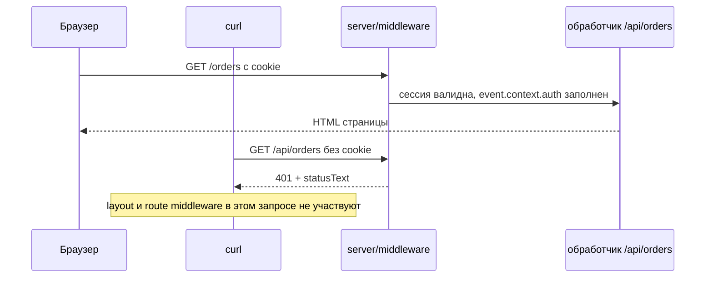

# Урок 08. Аутентификация и сессия

> **Идея в трёх строках**
> - Сессия — это httpOnly cookie плюс серверное знание: либо данные запечатаны в самой cookie, либо в cookie лежит только идентификатор, а данные в хранилище.
> - Проверка в `server/middleware` стоит на пути любого запроса, включая прямой `curl`; проверка в layout или в route middleware стоит только на пути отрисовки страницы.
> - «Страница не отрендерилась» и «данные не отданы» — это два разных обещания, и второе требует серверной проверки.

**Зачем это.** Пока приложение маленькое, логин кажется косметикой — редирект на `/login` выглядит как защита. Защитой он становится только после того, как кто-то руками дёрнет `/api/orders` и получит JSON. Этот урок про то, где живёт сессия и в какой точке проверка действительно закрывает данные.

## Сессия: cookie плюс серверное знание

Браузер прикладывает cookie к каждому запросу на тот же домен сам, без участия кода, поэтому cookie — это единственный транспорт, который одинаково работает и для HTML-страницы, и для `fetch` изнутри приложения. Флаг `httpOnly` означает, что значение недоступно из JavaScript на странице, то есть XSS не даёт прочитать сессию. В доке h3 cookie сессии описан с дефолтами `secure: true`, `httpOnly: true`, `sameSite: 'lax'`, `path: '/'`.

Дальше развилка, которая определяет всё остальное.

| | запечатанная cookie | id в cookie плюс хранилище |
| --- | --- | --- |
| где данные | в cookie, зашифрованные и подписанные | в базе, Redis или KV |
| размер | ограничен размером cookie | ограничен хранилищем |
| отзыв | смена секрета или истечение срока | удаление записи |
| цена проверки | расшифровать, без внешнего запроса | один запрос к хранилищу |

В первом варианте h3 даёт `useSession`: сессия пишется в cookie с зашифрованным содержимым, а пароль из опций запечатывает её. Дока прямо предупреждает, что энтропия этого пароля и есть граница безопасности: сама cookie содержит соль и подпись, поэтому слабый пароль подбирается офлайн. Второй вариант — тот, что описан в идее: в cookie едет `sid`, а состояние сессии лежит в таблице или в Redis, и тогда сессию можно отозвать одной записью.

## Почему `server/middleware`, а не layout

Дока Nuxt формулирует разницу без вариантов: route middleware работают внутри Vue-части приложения и, несмотря на похожее название, полностью отличаются от server middleware, которые работают в Nitro-части. Route middleware — это навигационный гард: он срабатывает при переходе на страницу, на сервере и повторно на клиенте при гидрации.

Отсюда два разных обещания.

«Страница не отрендерилась» — пользователь без сессии уходит на `/login`, потому что navigation guard остановил переход. Данные при этом остаются открытыми: следующий запрос пойдёт прямо в API, а это уже не переход на страницу, и гард в нём не участвует.

«Данные не отданы» — обработчик `/api/orders` не выполняется для запроса без сессии, потому что проверка стоит до маршрута. Дока Nuxt говорит, что server middleware выполняются на каждом запросе до любого серверного роута, и что они не возвращают ответ, а только смотрят или расширяют контекст либо бросают ошибку.

Побочное удобство этой модели: один и тот же middleware закрывает и страницу, и API, потому что рендер страницы это тоже запрос в Nitro. Отсюда единственное место проверки вместо двух. Отсюда же и цена: middleware срабатывает на каждый маршрут приложения, а не только на тот, который вы писали, поэтому условие по пути в нём — часть модели, а не украшение.



## Cookie-хелперы и готовый слой

На низком уровне всё делается четырьмя функциями h3: `parseCookies(event)` разбирает заголовок целиком, `getCookie(event, name)` берёт одно значение, `setCookie(event, name, value, options)` ставит, `deleteCookie(event, name)` удаляет.

```ts
// server/api/auth/login.post.ts
import { z } from 'zod'

const credentialsSchema = z.object({
  email: z.string().email(),
  password: z.string().min(8),
})

export default defineEventHandler(async (event) => {
  const { email, password } = await readValidatedBody(event, credentialsSchema)
  const user = await verifyCredentials(email, password) // ваш слой

  if (!user) {
    throw createError({ status: 401, statusText: 'Invalid credentials' })
  }

  const sessionId = await sessions.create(user.id) // server/utils/sessions.ts

  setCookie(event, 'sid', sessionId, {
    httpOnly: true,
    sameSite: 'lax',
    secure: true,
    path: '/',
    maxAge: 60 * 60 * 24 * 7,
  })

  return { id: user.id }
})
```

Здесь же типичная местная проблема: с `secure: true` браузер не отправит cookie по обычному http, и дока h3 прямо предупреждает, что на локальной разработке такие cookie молча отбрасываются (заметно в Safari и на части локальных доменов в Chrome). Лечится не отключением флага в проде, а флагом из конфига для dev-режима.

Готовый слой — `nuxt-auth-utils`. Модуль строит сессию на запечатанных cookie: `setUserSession(event, { user })`, `getUserSession(event)`, `clearUserSession(event)` и `requireUserSession(event)`, который сам отвечает 401, если в сессии нет `user`. На клиенте есть `useUserSession()`, а состояние тянется через служебный маршрут `/api/_auth/session`.

```ts
// server/api/notes.post.ts
export default defineEventHandler(async (event) => {
  const { user } = await requireUserSession(event) // 401, если в сессии нет user
  const body = await readValidatedBody(event, createNoteSchema)

  return createNote({ ...body, authorId: user.id })
})
```

Что стоит знать до подключения: для работы нужен `NUXT_SESSION_PASSWORD` не короче 32 символов; данные лежат в cookie, поэтому действует лимит размера cookie (модуль называет 4096 байт); модуль требует сервера — `nuxt generate` с ним не подходит. В README есть и совет не класть в сессию чувствительные данные, для них предусмотрено отдельное поле `secure`, доступное только серверным роутам.

## Где ломается

**1. Проверка в layout или в route middleware.**

Симптом ровно один и он проверяемый: `curl -s localhost:3000/api/orders` без cookie возвращает 200 и JSON. Страница при этом честно редиректит на логин, поэтому в браузере всё выглядит защищённым. Причина в том, что гард живёт в Vue-части и к API-маршруту отношения не имеет.

**2. Весь объект пользователя в запечатанной сессии.**

Права, аватар, список организаций и токены в cookie упираются в лимит её размера. Симптом: браузер перестаёт принимать cookie, и пользователь вылетает из сессии сразу после логина. В сессии остаётся то, что позволяет узнать пользователя, остальное читается из базы по id.

**3. Слабый секрет сессии.**

Дока h3 предупреждает: украденная cookie содержит соль и подпись в открытом виде, поэтому пароль с низкой энтропией подбирается офлайн, и увеличение числа итераций это не исправляет. Симптом не проявляется в логах вообще — утечка тихая. Секрет генерируется из криптостойкого источника и хранится в переменной окружения.

## Как это в проекте практики

Проект практики стоит не на `nuxt-auth-utils`, а на `@onmax/nuxt-better-auth` — модуле
поверх Better Auth: сессии живут в базе, а не в запечатанной cookie, поэтому лимит в 4096
байт здесь не мешает, зато каждый запрос с сессией читает таблицу. Имена хелперов те же:
`server/utils/requireRole.ts` вызывает `requireUserSession(event, { user: { role } })` и
получает 401/403 до выполнения обработчика, а `server/middleware/auth.ts` закрывает весь
`/api/*`, кроме явного списка публичных префиксов. Вывод урока от этого не меняется:
библиотека выбирает, где хранится сессия, а граница доверия всё равно на сервере.

## Попробуй · Deep Focus · 15 мин

1. Закройте `/api/*` серверным middleware:

   ```ts
   // server/middleware/auth.ts
   export default defineEventHandler(async (event) => {
     const { pathname } = getRequestURL(event)
     if (!pathname.startsWith('/api/')) return
     if (pathname === '/api/auth/login') return

     const session = await sessions.get(parseCookies(event).sid ?? '')
     if (!session) {
       throw createError({ status: 401, statusText: 'Unauthorized' })
     }

     event.context.auth = { userId: session.userId }
   })
   ```

2. Проверьте прямой запрос без cookie. Ожидаемо 401 и JSON ошибки, а не HTML страницы логина:

   ```bash
   curl -i localhost:3000/api/orders
   ```

3. Проверьте с сессией:

   ```bash
   curl -s -c jar.txt -X POST localhost:3000/api/auth/login \
     -H 'content-type: application/json' \
     -d '{"email":"me@example.com","password":"secret123"}'
   curl -i -b jar.txt localhost:3000/api/orders
   ```

4. Уберите проверку из `server/middleware` в `app/middleware` и повторите шаг 2. Данные снова отдаются, и это лучший аргумент в пользу серверной проверки.

## Правило в playbook

> Доступ проверяется на сервере до того, как данные покинули обработчик; всё, что проверяет страницу, защищает только страницу.

## Источники

- https://nuxt.com/docs/4.x/directory-structure/app/middleware
- https://nuxt.com/docs/4.x/directory-structure/server
- https://github.com/atinux/nuxt-auth-utils
- https://github.com/h3js/h3/blob/main/docs/4.examples/handle-session.md

**О версии.** Ссылка на пример сессий h3 ведёт в ветку `main` (h3 v2), а Nuxt 4 тянет h3 v1. Имена `getSession`, `useSession` и cookie-хелперов в обеих версиях совпадают, но детали хранения и опции могут отличаться, поэтому сверяйтесь с версией `h3` в `package.json`.

<!-- проверить: sessions.get/sessions.create в примерах это условный слой из server/utils, а не API библиотеки; в доке таких имён нет -->
<!-- проверить: примеры h3 в docs/4.examples/handle-session.md относятся к ветке main (h3 v2); Nuxt 4 сегодня ставит h3 v1, где useSession с тем же смыслом описан на v1.h3.dev, эту страницу открыть не удалось -->
<!-- проверить: утверждение про "браузер перестаёт принимать cookie" при превышении лимита сформулировано описательно, точного поведения конкретных браузеров я не проверял -->
