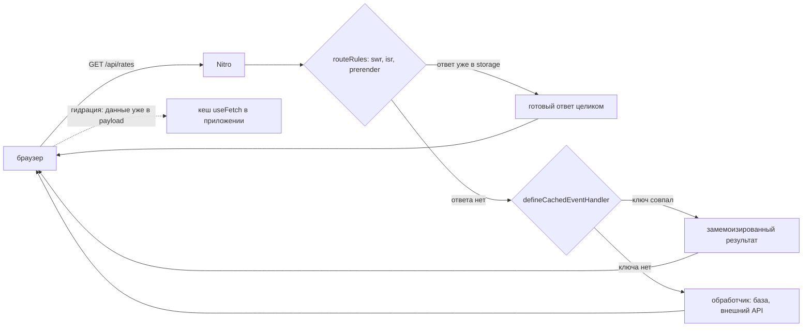

# Урок 09. Route rules и кеш

> **Идея в трёх строках**
> - Кеш в Nuxt живёт на трёх уровнях: `routeRules` в конфиге, `defineCachedEventHandler`
>   в Nitro и payload `useFetch` на клиенте.
> - Уровни решают разные задачи: правило на путь отвечает «что и на сколько кешировать»,
>   обработчик отвечает «чем один ответ отличается от другого», клиент отвечает «зачем
>   запрашивать то, что уже пришло с сервера».
> - Кеш ничего не знает про пользователя, пока вы сами не положили его в ключ, и это
>   главный источник утечек данных на бэкенде.

**Зачем это.** Кеш за пять минут добавляет скорости и за те же пять минут начинает
отдавать чужие данные, если навесить его на все пути подряд. После урока у вас есть
карта: какой уровень кеша где включается, что попадает в ключ, где этот кеш живёт и
какие роуты трогать нельзя вообще.

## Три уровня, три разных кеша

Кеш в Nuxt не один. Это три независимых механизма в трёх местах — и путаница между ними
даёт самые странные баги.



| Уровень | Где включается | Что кеширует | Из чего складывается ключ |
| --- | --- | --- | --- |
| `routeRules` | `nuxt.config.ts` | ответ роута целиком, вместе с заголовками | путь URL |
| `defineCachedEventHandler`, `cachedFunction` | код в `server/` | результат функции | ваш `getKey` либо хеш аргументов |
| `useFetch` | код в `app/` | данные компонента и запись в payload | `key`, по умолчанию из URL, опций и места вызова |

Разница практическая. `routeRules` не требуют правок в обработчике — это правило на путь,
которое Nuxt превращает в обёртку над роутом через кеширующий слой Nitro. Второй уровень
живёт в коде и знает про аргументы функции. Третий вообще не про сервер — он про то, чтобы
один и тот же запрос не уходил дважды, с сервера и с клиента.

Третий уровень стоит понять отдельно, потому что он не про время, а про повторный вызов.
`useFetch` кладёт результат в payload, и при гидрации клиент берёт данные оттуда, а не идёт
в сеть заново. Поэтому «кеш» здесь означает «не запрашивать то, что уже пришло с сервера».
Ключ по умолчанию собирается из URL, опций и места вызова, поэтому два разных компонента с
одним адресом живут каждый со своим запросом; общий `key` включает шаринг состояния.
Поведение подменяется опцией `getCachedData`, а читать и чистить записи можно через
`useNuxtData` и `clearNuxtData`.

## Route rules: правила на путь

```ts
// nuxt.config.ts
export default defineNuxtConfig({
  routeRules: {
    '/': { prerender: true },
    '/pricing': { swr: 3600 },
    '/blog/**': { isr: 3600 },
    '/docs/**': { headers: { 'cache-control': 'public, max-age=600' } },
    '/api/**': { cors: true },
  },
})
```

Ключи из примера делают разное, хотя выглядят похоже.

`prerender: true` отдаёт страницу из сборки — на запросе сервер не работает вовсе.
`swr: 3600` кеширует полный ответ на сервере или на обратном прокси на час; в доке
отдельно отмечено, что полный ответ умеет кешировать пресет `node-server`. Когда TTL
истёк, клиент получает закешированный ответ, а страница перегенерируется в фоне.
`isr: 3600` ведёт себя так же, но добавляет ответ в кеш CDN на платформах, которые это
умеют, сейчас это Netlify и Vercel; при `isr: true` содержимое живёт до следующего
деплоя. Если указать `swr: true` без числа, добавляется заголовок `stale-while-revalidate`
без `MaxAge`.

Полезная деталь: роуты с `isr` или `swr` дополнительно генерируют `_payload.json` рядом
с HTML, и переход по клиентской навигации читает этот закешированный payload вместо
нового запроса за данными. То есть кеш страницы и кеш данных на клиенте связаны крепче,
чем кажется.

Ещё две детали из той же страницы. Гибридный рендеринг не работает с `nuxt generate`: для
статической сборки правила и кеш устроены иначе, и включать `swr` в пререндеренном проекте
смысла нет. И там, где это возможно, Nuxt переносит route rules в родные правила платформы
(сейчас это Netlify и Vercel) — так что часть кеша живёт не в вашем сервере, а на CDN, и
инвалидация у него своя.

В `routeRules` живут не только кеш-ключи — `headers`, `cors`, `redirect`, `proxy`,
`ssr: false` для отдельных секций сайта. Это одно место для правил «на путь» — и читать
его целиком полезнее, чем искать по коду.

## defineCachedEventHandler: ключ и TTL

```ts
// server/api/rates.get.ts
export default defineCachedEventHandler(async () => {
  return await $fetch('https://api.example.com/rates')
}, {
  maxAge: 60 * 60,
  swr: true,
  staleMaxAge: 60 * 60 * 24,
  getKey: () => 'latest',
})
```

Опции читаются буквально, и три из них легко понять неправильно.

`maxAge` по умолчанию равен одной секунде, поэтому «навесил кеш, а он не работает» почти
всегда означает пропущенный `maxAge`. `swr` в Nitro 2 по умолчанию `true`: старый ответ
уходит клиенту, пока в фоне считается новый, а `swr: false` заставляет ждать свежее
значение. `staleMaxAge` ограничивает срок жизни устаревшего ответа, по умолчанию `0`
(устаревшее не отдаётся), а `-1` разрешает отдавать его без ограничения.

Второй момент важнее первого — при кешировании обработчик видит не весь запрос. Дока
формулирует прямо: все входящие заголовки отбрасываются, и только перечисленные в
`varies` учитываются при кешировании и отдаче. То есть внутри `defineCachedEventHandler`
не стоит читать `event.context.user` или cookie — они либо пустые, либо не влияют на ключ.

Ключ собирается по шаблону `group:name:getKey().json`, например
`nitro:functions:getAccessToken:default.json`. Пересчитать кеш вручную можно через
`useStorage('cache').removeItem(...)` с тем же ключом. И ещё: в продакшене кеш по
умолчанию лежит в памяти процесса, а не на диске. В кластере из четырёх воркеров у вас
четыре независимых кеша, и общий кеш — это уже отдельная работа с драйвером вроде redis.

Уровни складываются, но не заменяют друг друга. Правило с `swr` кеширует ответ целиком,
включая тело, а `defineCachedEventHandler` внутри того же роута кеширует результат функции.
Включать оба сразу почти никогда не нужно: поверх одного TTL появляется второй, и при
разборе «почему данные старые» придётся выяснять, какой слой отдал ответ. Один роут, один
уровень кеша, а исключения из этого правила лучше делать осознанно.

## Почему персональный ответ кешировать нельзя

Ключ обработчика и ключ правила строятся из URL. Пользователя в этом ключе нет — cookie и
заголовки при кешировании отбрасываются. Значит `/api/me` с кешем отвечает не тому, кто
спросил, а тому, чей ответ попал в кеш первым. Симптом предельно неприятный — после смены
аккаунта страница показывает прошлого пользователя, а на другом устройстве с той же
ссылкой виден чужой профиль.

Обход «добавлю `varies: ['cookie']`» формально работает, но кеш перестаёт быть кешем —
запись на каждое значение cookie, а cookie меняется при каждом логине и ротации токена.
Плюс `varies` рассчитан на заголовки вроде `host` в мультитенантности, а не на
идентичность пользователя.

Рабочая схема для страницы с персональными данными: публичная часть кешируется
агрессивно, персональная приходит отдельным запросом без кеша. Если кеш персонального
ответа всё-таки нужен, пользователь входит в ключ явно, а TTL становится коротким, и это
уже отдельное проектное решение, а не настройка по умолчанию.

Отдельная тонкость: кеш в памяти процесса живёт до перезапуска, а на нескольких инстансах
у каждого он свой. Проблему персональных данных это не отменяет, а маскирует: утечка
воспроизводится через раз, зависит от того, на какой инстанс попал запрос, и потому живёт
в проде месяцами, пока кто-то не увидит чужой профиль своими глазами.

## Где ломается

**1. Кеш на всё API.**

```ts
// nuxt.config.ts
export default defineNuxtConfig({
  routeRules: { '/api/**': { swr: 60 } }, // ❌ вместе с /api/me и /api/orders
})
```

Правило по маске не различает публичные и приватные роуты. Симптом: в течение минуты
разные пользователи получают один и тот же ответ.

**2. Кеш вокруг обработчика, читающего контекст.**

Обработчик берёт юзера из `event.context`, куда его положил middleware, и оборачивается в
`defineCachedEventHandler`. Контекст в ключ не входит — поэтому первый ответ расходится на
всех до истечения TTL. Кешируется «функция без аргументов», а не «ответ для пользователя».

**3. `maxAge` забыт, и кеш выглядит сломанным.**

По умолчанию одна секунда — локально на двух запросах подряд разницы не видно, а в проде
под нагрузкой кеш почти не срабатывает. Второй вариант той же ошибки на клиенте: после
мутации через `$fetch` данные в `useFetch` остаются старыми, пока их не обновить через
`refresh` или `clearNuxtData`.

## Как это в проекте практики

`routeRules` в проекте пока нет — это честный пробел, а не секрет. Кеш стоит только там,
где его легко доказать: раздача загрузок `server/routes/uploads/[...path].get.ts` отдаёт
`cache-control: public, max-age=31536000, immutable`, потому что имя файла — случайный id
и содержимое по адресу не меняется. Персональные ручки при этом живут без кеша вовсе.

## Попробуй · Deep Focus · 15 мин

1. Возьмите публичный роут без персональных данных (курсы, список городов, категории) и
   навесьте на него `swr: 60`. Внутри обработчика поставьте `console.log` с временем
   вызова.

2. Сделайте два запроса подряд, потом третий через минуту. В логе сервера вызов
   обработчика появляется один раз на TTL, а ответ приходит сразу даже после истечения.

3. Найдите в проекте роут, который читает cookie или сессию, и убедитесь, что на нём нет
   ни правила с `swr`/`isr`, ни `defineCachedEventHandler`. Если есть, снимите кеш и
   проверьте, что данные снова меняются сразу.

## Правило в playbook

> Кеш различает ответы по URL, пока вы сами не положили пользователя в ключ — поэтому
> персональный роут живёт без кеша.

## Источники

- https://nuxt.com/docs/4.x/guide/concepts/rendering
- https://raw.githubusercontent.com/nitrojs/nitro/v2.13.5/docs/1.guide/6.cache.md
- https://nuxt.com/docs/4.x/api/composables/use-async-data

<!-- проверить: имена defineCachedEventHandler и cachedFunction относятся к Nitro 2, на котором стоит Nuxt 4. В доке nuxt.com он назван движком Nuxt 3 и 4, а Nitro 3 придёт с Nuxt 5; там же эти функции переименованы в defineCachedHandler и defineCachedFunction, и опции переехали в nitro/cache. Проверьте имена по версии nitropack в package.json. -->
<!-- проверить: в этом окружении v2.nitro.build/guide/* не открывался (таймаут), поэтому ссылка на кеш ведёт в официальный репозиторий Nitro на теге v2.13.5. -->
