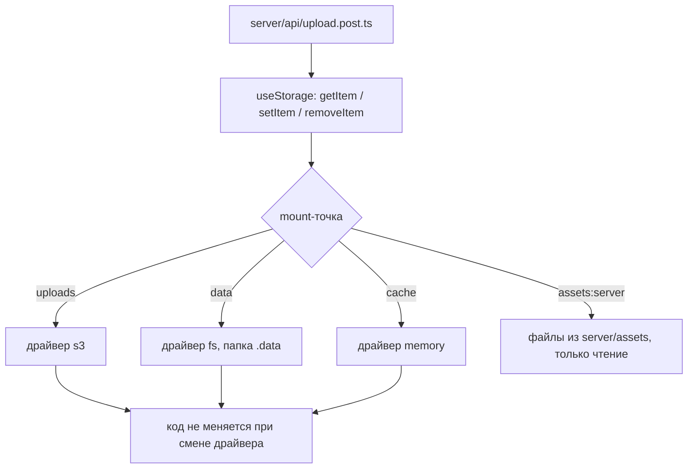

# Урок 10. Storage layer

> **Идея в трёх строках**
> - `useStorage` даёт один интерфейс `getItem` / `setItem` к диску, памяти, S3 и redis —
>   меняется драйвер, код остаётся.
> - Точка монтирования (`storage: { uploads: { driver: 's3' } }`) связывает имя в коде с
>   настоящим хранилищем, а настройки драйвера приходят из `runtimeConfig`.
> - Локальный диск на serverless — это не диск: файл переживает запрос, но не следующий
>   запуск инстанса.

**Зачем это.** Пока файлы лежат в `public/`, всё просто и всё неправильно — пользовательская
картинка, попавшая в бандл, публична и неизменяема. Урок разделяет три вида файлов и
показывает, как писать код, который одинаково работает локально и на платформе без
файловой системы.

## Один интерфейс, много драйверов

Storage в Nitro — это слой над unstorage: у вас есть именованные хранилища и единый
асинхронный API. Ключ — это строка вида `uploads:avatars/42.png`, а куда физически уходит
значение, решает драйвер mount-точки.



Драйверов много, и список живёт в документации unstorage — `fs`, `memory`, `s3`, `redis`,
облачные KV, бакеты и blob-хранилища платформ. Практическая ценность в том, что
`useStorage('uploads').setItem(...)` выглядит одинаково для диска и для бакета.

Три особенности API видны сразу. Префикс можно вынести в аргумент:
`useStorage('test').setItem('foo', ...)` и `useStorage().setItem('test:foo', ...)` это одна
запись. Тип значения задаётся дженериком. Хранилище по умолчанию держится в памяти, а
mount-точка `data` пишет в папку `.data`.

Держите в голове, что это key-value, а не файловая система. Значение адресуется ключом,
JSON сериализуется и разбирается автоматически, а как драйвер хранит байты, зависит от
драйвера. Практическое следствие — код, который перебирает каталог или опирается на
«соседние» файлы, приехал из модели диска. В KV-модели перебор — это отдельная операция, и
поддержка её у разных драйверов разная, поэтому такую логику проверяют до переезда, а не
после.

## Три вида файлов, которые нельзя путать

**`public/`.** Файлы оттуда отдаются с корня и сборкой не изменяются. Это место для
`robots.txt`, `favicon.ico`, картинки для соцсетей: того, что не меняется и чьё имя важно.
Пользовательской загрузке здесь не место — файл попадает в артефакт деплоя.

**`server/assets/`.** Это файлы для сервера: шаблоны писем, справочники JSON, статические
тексты. Они попадают внутрь серверного бандла, после сборки их можно найти в
`.output/server/chunks/raw/`, а читаются они через mount-точку `assets:server`. Дока
предупреждает про размер: ассеты едут вместе с сервером, поэтому гигабайт картинок здесь
испортит холодный старт. Через `serverAssets` в конфиге Nitro можно подключить и внешнюю
папку со своим `baseName`.

**Storage.** Всё, что появляется во время работы: загруженные файлы, аватары, отчёты,
временные выгрузки. Именно здесь нужен драйвер, и именно здесь код не привязан к файловой
системе.

Правило выбора короткое. Если файл готовит разработчик и он не меняется, это `public` или
`server/assets`. Если файл создаёт пользователь или процесс, это storage, даже когда речь о
крошечном JSON. Ошибка в этом месте почти всегда одна: данные времени работы кладут в
папку, которая едет в артефакт деплоя, и потом удивляются, почему их не видно на втором
инстансе.

## Драйвер из runtimeConfig

```ts
// nuxt.config.ts
export default defineNuxtConfig({
  runtimeConfig: {
    redis: { host: '', port: 0 },
  },
  nitro: {
    storage: {
      uploads: { driver: 'fs', base: './.data/uploads' },
    },
  },
})
```

```ts
// server/api/upload.post.ts
export default defineEventHandler(async (event) => {
  const { filename, base64 } = await readBody<{ filename: string, base64: string }>(event)
  if (!filename || !base64) {
    throw createError({ status: 400, statusText: 'filename and base64 are required' })
  }

  const key = `avatars/${Date.now()}-${filename}`
  await useStorage('uploads').setItem(key, base64)

  return { key, url: `/files/${key}` }
})
```

Так выглядит код, который не знает, где лежит файл. Дальше два способа подставить настоящее
хранилище.

Первый: объявить mount-точку в `nitro.storage` и менять её конфигом под окружение.
Значения `runtimeConfig` переопределяются переменными с префиксом `NUXT_`, а в
`nuxt.config` остаются пустые значения по умолчанию.

Второй: смонтировать драйвер в Nitro-плагине на старте, где доступен `useRuntimeConfig()`:

```ts
// server/plugins/storage.ts
import redisDriver from 'unstorage/drivers/redis'

export default defineNitroPlugin(() => {
  const config = useRuntimeConfig()
  useStorage().mount('uploads', redisDriver({
    base: 'uploads',
    host: config.redis.host,
    port: config.redis.port,
  }))
})
```

Дока честно называет этот способ временным обходным решением и ссылается на issue про
конфигурацию, известную только в рантайме. Для продакшена с настройками из env он всё
равно удобнее: `nuxt.config` не содержит адресов и паролей, а mount появляется при старте
процесса. Конкретные опции каждого драйвера смотрите на его странице в доке unstorage: у
S3, R2 и redis они разные.

Порядок решений для новой фичи простой. Сначала вопрос «что это за данные»: конфигурация
сборки живёт в `public` или в `server/assets`, файл пользователя идёт в mount-точку, а
состояние процесса в `data`. Потом вопрос «какой драйвер в каком окружении»: ответ
записывается в конфиг, а не в код. И только последним вопросом идёт «свой драйвер», потому
что написать адаптер несложно, а поддерживать его придётся столько же, сколько и остальной
бэкенд.

Отдельно про разработку: Nitro в dev монтирует несколько служебных точек (`root`, `src`,
`cache`, `build`), а ключ `devStorage` позволяет в dev держать `fs`, пока в проде настроен
redis. Один и тот же код — разные драйверы. Служебные точки существуют только в разработке:
`build` содержит файлы, которые сгенерировал Nitro, и в продакшене таких ключей нет. Код,
который читает `build`, в проде честно упадёт, поэтому такие обращения живут в dev-скриптах
и в задачах сборки, а не в обработчиках.

## Почему на serverless диск это не диск

Дока по edge-воркерам перечисляет ограничения без обиняков — нет доступа к файловой
системе, время исполнения ограничено (обычно 15–30 секунд), размер бандла небольшой.
Отсюда следует главное правило: если в коде есть `path.join` и `fs.writeFile`, код привязан
к рантайму, у которого есть диск.

Дальше два сценария. На node-сервере с постоянным диском `fs`-драйвер работает, но файлы
живут на одном инстансе: при переезде на второй инстанс и при пересборке контейнера
локальная папка теряется. На serverless файл может не дожить даже до второго запроса.

Storage не отменяет эти ограничения, но переносит выбор в конфиг — там, где диска нет,
mount-точка указывает на бакет или KV, а обработчик не меняется ни на строку.

Есть и третий сценарий, о котором вспоминают позже — работа большая, а запрос короткий.
Storage здесь выступает не хранилищем файлов, а местом состояния. Задача пишет туда
прогресс и указатель на следующий шаг, следующий запуск читает его и продолжает с того же
места. Так работа режется на куски, каждый из которых укладывается в лимит платформы, а
логика «где мы остановились» перестаёт жить в памяти процесса.

## Где ломается

**1. `fs` с относительным `base` уехал в прод.**

```ts
// nuxt.config.ts
nitro: {
  storage: { uploads: { driver: 'fs', base: './uploads' } }, // ❌ на платформе без диска
},
```

Локально файл на месте, на деплое загрузка отвечает успехом, а следующий запрос отдаёт
404 — инстанс другой. Симптом тем неприятнее, что ошибки нет.

**2. Пользовательский файл положили в `public/`.**

`public/` не изменяется сборкой и отдаётся с корня, поэтому такой файл публичен, а заменить
его можно только новой сборкой. Загрузка в `server/assets/` даёт тот же эффект плюс рост
серверного бандла — дока прямо предупреждает про размер ассетов.

**3. Настройки драйвера вписаны в `nitro.storage`.**

Тогда адреса и пароли лежат в конфиге проекта и попадают в сборку, а на другом окружении
их не переопределить через env. Лечение: `runtimeConfig` плюс монтирование в плагине.

## Как это в проекте практики

Проект практики сознательно живёт на диске: пресет `node-server`, загрузки в `uploads/`
вне `public/`, запись — `server/utils/media.ts`, раздача — `server/routes/uploads/[...path].get.ts`.
Обработчики `fs` и `path` не трогают, но от рантайма с диском проект зависит: переезд на
платформу без диска потребует заменить эти два файла на драйвер `useStorage`, а ручки
загрузки и чтения останутся как есть. Это и есть цена решения — не в количестве кода, а в
точке, где его придётся менять.

## Попробуй · Deep Focus · 20 мин

1. Добавьте `server/api/upload.post.ts` с `useStorage('uploads')` и mount-точку `uploads`
   на драйвере `fs`.

2. Сделайте `server/routes/files/[key].get.ts`, который читает значение через
   `useStorage('uploads').getItem(key)` и возвращает его; проверьте, что загруженный файл
   читается по тому же ключу.

3. Смонтируйте драйвер в `server/plugins/storage.ts` и переключите `uploads` на другой
   драйвер (в dev достаточно `fs` с другой папкой, в проде облачный). Убедитесь, что
   обработчики загрузки и чтения не изменились ни на строку — это и есть проверка, что
   слой выбран правильно.

## Правило в playbook

> Файлы времени работы ходят через `useStorage`, а драйвер выбирается конфигом: `path.join`
> и `fs` в обработчике привязывают проект к рантайму с диском.

## Источники

- https://raw.githubusercontent.com/nitrojs/nitro/v2.13.5/docs/1.guide/4.storage.md
- https://raw.githubusercontent.com/nitrojs/nitro/v2.13.5/docs/1.guide/8.assets.md
- https://nuxt.com/docs/4.x/directory-structure/public
- https://raw.githubusercontent.com/nitrojs/nitro/v2.13.5/docs/2.deploy/1.workers.md

<!-- проверить: раздел «Server Assets» в нынешней доке nuxt.com по server/ не описывается, поэтому поведение server/assets и mount-точка assets:server взяты из доки Nitro 2. Проверьте, что папка server/assets подхватывается в вашей версии Nuxt. -->
<!-- проверить: имена драйверов fs, memory, s3, redis сверены по каталогу src/drivers в репозитории unstorage, а страница nitro.build/guide/storage в этом окружении не открывалась (таймаут). Опции драйверов берите из доки unstorage для своей версии. -->
<!-- проверить: пример с redis-драйвером повторяет код из доки Nitro (base, host, port). Для других драйверов имена опций отличаются, их я не проверял. -->
