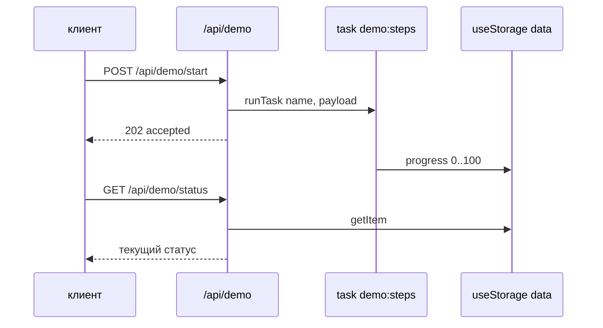

# Урок 11. Долгие задачи

> **Идея в трёх строках**
> - Работа, которая не успевает в ответ на запрос, живёт отдельно: Nitro task — это
>   именованная серверная операция, а не роут.
> - Задачу запускают из CLI, по расписанию или из обработчика через `runTask`, и во всех
>   трёх случаях она живёт вне жизненного цикла запроса.
> - Отдать прогресс можно тремя способами: polling, SSE, websockets. Транспорт выбирает
>   рантайм: SSE работает поверх обычного HTTP, websockets требуют соединения, которое
>   рантайм держит.

**Зачем это.** Отчёт на десять тысяч строк, реиндексация, рассылка — всё это хочется
запустить из интерфейса и забыть. Если такая работа висит внутри запроса, её убивает
таймаут платформы, и пользователь видит 502 после тридцати секунд ожидания. Урок разделяет
«запустить работу» и «узнать её результат».

## Задача и запрос это разные вещи

Сравнение снимает почти всю путаницу.

| | HTTP-запрос к роуту | Nitro task |
| --- | --- | --- |
| Что инициирует | клиент, каждый раз | CLI, расписание или роут |
| Сколько живёт | пока клиент ждёт ответ | сколько нужно работе |
| Что возвращает | тело ответа | `{ result }` из `run` |
| Виден ли снаружи | да, это публичный путь | только через dev-эндпоинты и обёртку |
| Повторный запуск | новый запрос | параллельный вызов ждёт общий результат |

```ts
// server/tasks/db/seed.ts → имя задачи db:seed
export default defineTask({
  meta: {
    name: 'db:seed',
    description: 'Run database seed',
  },
  async run({ payload }) {
    const raw = payload && typeof payload === 'object' && 'count' in payload ? payload.count : 10
    const count = Number(raw)
    // ... настоящая работа
    return { result: `seeded ${count} rows` }
  },
})
```

Файл лежит в `server/tasks/[name].ts`, вложенные папки дают имя через двоеточие:
`server/tasks/db/seed.ts` превращается в `db:seed`. Задачи в Nitro 2 помечены
экспериментальными и включаются флагом `nitro: { experimental: { tasks: true } }` в
`nuxt.config`. Без флага каталог `tasks` не сканируется, и задача просто не находится.

У задач есть особенность, которая отличает их от очереди — у каждого имени одна
выполняющаяся копия. Параллельные вызовы `db:seed` не запускают вторую задачу, все
получают результат одного прогона. Для «не запускай дважды» это подарок, для «запусти
параллельно по разным параметрам» ограничение.

И ещё одно отличие от очереди, которое видно по API — в `defineTask` есть только `meta` и
`run`. Ни повторов при ошибке, ни истории прогонов, ни списка уже выполненных задач в этом
интерфейсе нет. Значит прогресс, результат и отметку «упало» сохраняет сама задача, обычно
в `useStorage`, а описание задачи остаётся декларативным: имя, описание, работа. Если нужен
полноценный брокер с ретраями и разными очередями, это уже отдельный сервис, а не Nitro
tasks.

Отдельно про дев-режим: dev-сервер сам выставляет список задач и запуск по HTTP. Список
доступен на `/_nitro/tasks`, запуск по имени на `/_nitro/tasks/:name`, причём payload можно
передать и query-параметрами, и телом с ключом `payload`. Это удобно для отладки и не
предназначено для продакшена — в проде ту же роль играет ваш роут с проверкой прав.

## Запуск: CLI, расписание, роут



В разработке самый быстрый способ проверить задачу — это CLI. В Nitro это `nitro task list`
и `nitro task run db:migrate --payload "{}"`, и оба работают только при запущенном
dev-сервере, из второго терминала. В Nuxt CLI то же самое называется `npx nuxt task list`
и `npx nuxt task run db:seed --payload '{"count":10}'`: команда идёт через запущенный
`nuxt dev`, ключ `--url` позволяет указать другой сервер, а результат печатается как JSON.

Расписание задаётся в конфиге Nitro через `scheduledTasks` и cron-выражение. Тут начинается
первая зависимость от платформы — дока перечисляет поддержку расписания для `dev`,
`node-server`, `bun` и `deno-server`, а на Cloudflare расписание — это родные Cron Triggers,
которые настраиваются ещё и в конфиге платформы.

Запуск из обработчика выглядит как `runTask('db:seed', { payload })`. Дока рядом с этим
примером ставит предупреждение, которое звучит как «аутентифицируй пользователя и проверь
payload». Причина простая: `runTask` не проверяет ничего — это обычная функция, и роут с ней
становится кнопкой «сделай тяжёлую операцию» для любого, кто знает адрес. Пока задача пишет
прогресс в `useStorage('data')`, роут может только запускать её и отдавать текущий статус.

## Что выбрать для прогресса

Три транспорта решают одну задачу — показать, как идёт работа, начатая в другом месте.

**Polling.** Клиент раз в пару секунд дергает `/api/demo/status`, сервер читает статус из
storage. Работает везде, где работает HTTP, не требует ни соединения, ни платформенных
возможностей, и его легко отладить. Плата — это лишние запросы и задержка между состоянием
работы и его отображением.

**SSE.** Открытое HTTP-соединение, по которому сервер пушит события в одну сторону. В Nitro
это `createEventStream(event)`: обработчик делает `push`, подписывается на `onClosed` и
возвращает `send()`. Клиенту хватает `EventSource`. Ограничение важное — соединение живёт,
пока его держит рантайм, и на serverless с коротким лимитом исполнения оно умирает вместе с
инвокацией.

**Websockets.** Двусторонний канал, нужен, когда клиент тоже говорит: чат, совместное
редактирование, команды. В Nitro 2 — это экспериментальная фича с флагом
`experimental: { websocket: true }` и обработчиком `defineWebSocketHandler` в
`server/routes/_ws.ts`. Дока прямо отправляет проверять поддержку платформ в отдельный
issue, и это правильный сигнал — websockets требуют long-running рантайма, а не «функции на
запрос».

Развилка короткая. Если данные меняются редко и клиентов много, берём polling и не
усложняем. Если нужно пушить состояние в одну сторону (прогресс, логи, уведомления), берём
SSE: он ближе всего к тому, что уже есть. Websockets берём, когда действительно нужен
двусторонний обмен и платформа его держит.

Цена у этих вариантов разная, и её полезно назвать до выбора. Polling стоит одного запроса
за клиента на интервал, но каждый такой запрос проходит весь путь до базы или до storage —
на сотне открытых вкладок это заметно, зато отладка сводится к чтению логов. SSE держит по
соединению на клиента, и это уже давление на память и на лимиты платформы, зато состояний
и таймеров в клиентском коде меньше. Websockets держат соединение и добавляют протокол
сообщений, который теперь живёт в двух местах. Начинать с самого дешёвого варианта дешевле,
чем переписывать транспорт в середине проекта.

## Где ломается

**1. Долгая работа осталась внутри обработчика.**

```ts
// server/api/reindex.post.ts
export default defineEventHandler(async () => {
  await reindexEverything() // ❌ минуты работы в одном запросе
  return { ok: true }
})
```

Дока по edge-воркерам называет лимит исполнения в 15–30 секунд. Симптом: запрос обрывается
по таймауту, работа теряется, а клиент не знает, началась ли она. Лечение архитектурное:
работа живёт в задаче, а запрос только запускает её и отдаёт статус.

**2. `runTask` торчит в публичном роуте без проверок.**

Пример из доки намеренно оставлен с предупреждением про аутентификацию, и его часто
копируют без этой строчки. Симптом: миграция или рассылка запускается первым же запросом
снаружи.

**3. Задача или websocket не включены флагом.**

`experimental: { tasks: true }` и `experimental: { websocket: true }` в Nitro 2 не косметика —
без них каталог задач не сканируется, а upgrade-запросы не обслуживаются. Симптом
нейтральный: «задача есть в файлах, но её нет в списке» и «соединение не устанавливается».

## Как это в проекте практики

Задач в проекте нет: вся работа пока укладывается в запрос. Проверка по карте практики так
и показывает «в проекте этого нет» — это не поломка, а место, где практика урока обгоняет
боевой проект.

## Попробуй · Deep Focus · 20 мин

1. Сделайте `server/tasks/demo/steps.ts` с `defineTask`, включите `experimental.tasks` и
   запустите `npx nuxt task run demo:steps --payload '{"count":3}'`. Убедитесь, что имя
   задачи пришло из пути файла.

2. Оберните запуск в `server/api/demo/start.post.ts` через `runTask` и верните `202`. Пусть
   задача пишет прогресс в `useStorage('data').setItem('demo:progress', ...)`.

3. Добавьте `server/api/demo/status.get.ts`, который отдаёт этот прогресс, и обновите
   страницу с polling раз в секунду. Это скучный, но честный вариант, который работает на
   любой платформе; SSE добавляйте только если пуша действительно не хватает.

## Правило в playbook

> Долгая работа не живёт в запросе: запрос запускает задачу и отдаёт статус, а транспорт для
> статуса выбирается по рантайму.

## Источники

- https://raw.githubusercontent.com/nitrojs/nitro/v2.13.5/docs/1.guide/10.tasks.md
- https://nuxt.com/docs/4.x/api/commands/task
- https://raw.githubusercontent.com/nitrojs/nitro/v2.13.5/docs/1.guide/3.websocket.md
- https://raw.githubusercontent.com/nitrojs/nitro/v2.13.5/docs/2.deploy/1.workers.md

<!-- проверить: tasks и websocket в Nitro 2 помечены как experimental; проверьте флаги и статус поддержки на своей версии nitropack и на своей платформе (дока ссылается на issue по поддержке websocket). -->
<!-- проверить: createEventStream и send() показаны в разделе про SSE в доке Nitro 2; полный гид по SSE лежит в доке h3 v1, я его не открывал. -->
