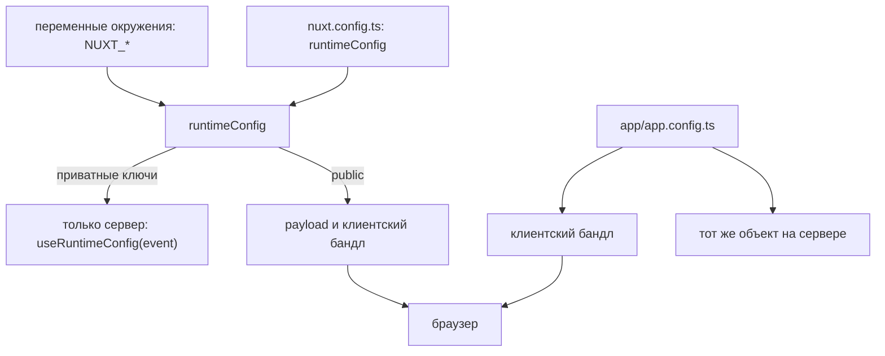

# Урок 12. Деплой и секреты

> **Идея в трёх строках**
> - `runtimeConfig` — это то, что меняется на деплое и переопределяется переменными
>   окружения в рантайме; `app.config` — это то, что уже уехало в бандл и потому публично.
> - Переменная с префиксом `NUXT_` попадает в ключ `runtimeConfig` по имени, а `.env`
>   читается при разработке и сборке, но не при запуске собранного сервера.
> - Nitro preset определяет, какие возможности у вас вообще есть: файловая система,
>   websockets, долгие процессы, расписание.

**Зачем это.** Девять из десяти «работает локально, падает в проде» — это конфигурация:
секрет попал не туда, переменная названа не так, пресет собран не тот. Урок даёт две модели
(что публично и что меняется на деплое) и один порядок действий при выкатке.

## Две конфигурации с разной судьбой

В Nuxt два разных конфига, и различаются они не синтаксисом, а судьбой значения.



| | `runtimeConfig` | `app.config` |
| --- | --- | --- |
| Кто меняет | окружение на деплое | разработчик в коде |
| Куда попадает | сервер целиком, клиенту только `public` | клиентский бандл целиком |
| Секреты | да, в приватной части | нет, никогда |
| Как обновить | перезапуск с новыми env | правка файла и новая сборка |
| Доступ | `useRuntimeConfig()` | `useAppConfig()` |

Дока про `app.config` пишет это одной строкой — не кладите туда секреты, файл попадает в
клиентский бандл. Значит ключ API, попавший в `app.config`, уже опубликован, даже если в
интерфейсе он нигде не показан.

У `runtimeConfig` деление внутри: ключи верхнего уровня доступны только на сервере, а всё
из секции `public` уезжает клиенту и добавляется в payload каждой страницы. На сервере
конфиг доступен целиком, но только для чтения; в браузере он реактивный и записываемый, и
это ровно тот случай, где удобство легко превращается в утечку: передать приватный ключ в
`useState` и отдать его в HTML проще, чем кажется.

Есть и техническое ограничение, о котором узнают на первом деплое с объектом в конфиге —
`runtimeConfig` сериализуется перед передачей в сервер. Значит функции, `Set` и `Map` в
`nuxt.config` задавать нельзя, они не переживут сериализацию. Таким вещам место в
Nuxt-плагине или в Nitro-плагине, а в конфиге остаются примитивы и обычные объекты.

Про `app.config` полезно знать ещё две вещи. С Nuxt 3.3 файл общий с Nitro, поэтому в нём
нельзя импортировать Vue-компоненты, а часть автоимпортов в серверном контексте недоступна;
в Nitro 3 поддержку app config на сервере планируют убрать совсем. И типы: в серверных
роутах ключи из `app.config` выводятся как `unknown`, а `runtimeConfig` можно расширить
руками через `nuxt/schema`. Для конфигурации, которую читает сервер, это лишний аргумент в
пользу `runtimeConfig`.

## Как переменная окружения попадает в runtimeConfig

```ts
// nuxt.config.ts
export default defineNuxtConfig({
  runtimeConfig: {
    apiSecret: '',            // NUXT_API_SECRET
    public: {
      apiBase: '/api',        // NUXT_PUBLIC_API_BASE
    },
  },
})
```

```ini
# .env
NUXT_API_SECRET=api_secret_token
NUXT_PUBLIC_API_BASE=https://example.com
```

Правило маппинга одно — имя переменной начинается с `NUXT_`, а дальше путь по объекту
записывается в верхнем регистре через `_`. `runtimeConfig.public.apiBase` превращается в
`NUXT_PUBLIC_API_BASE`.

Два условия, без которых маппинг не работает. Переменную нужно объявить в `nuxt.config`
(иначе произвольный env не попадёт в код), и подменять можно только ключ с правильным
именем. Дока отдельно предупреждает про трюк «поставить дефолтом `process.env.OTHER_VARIABLE`»:
он работает при сборке и ломается в рантайме, потому что подстановка значений происходит
уже после сборки.

Ещё две мелочи, которые дают часы отладки. Значения из env кастуются к типу через `destr`:
`NUXT_MY_VAR=4848e0` станет числом `4848`. Если нужна строка, её пишут с кавычками внутри
значения, и до процесса эти кавычки доходят только буквально. И `.env` читает CLI Nuxt в
разработке, при сборке и генерации, но не при запуске собранного сервера —
`node .output/server/index.mjs` не подхватит `.env` из папки проекта.

В серверном коде конфиг берут с событием: `useRuntimeConfig(event)`. Дока говорит, что
аргумент можно опустить, но рекомендует передавать его, чтобы значения переопределились env
в рантайме.

## Пресет решает, что доступно

`nuxt build` собирает бандл под конкретный рантайм, и рантайм выбирается пресетом:
`nitro.preset` в конфиге или переменная `NITRO_PRESET` при сборке (в доке Nitro рядом
упоминается и `SERVER_PRESET`, плюс флаг `--preset`). Без указаний это `node-server`.

```bash
NITRO_PRESET=node-server npx nuxt build
ls .output
node .output/server/index.mjs
```

В `.output` два каталога. `public` — это статика, которую отдают клиенту. `server` — это
серверный бандл; у node-пресета внутри лежит `index.mjs`, и запуск именно его поднимает
прод-сервер на порту 3000. Порт и хост переопределяются через `NITRO_PORT` (или `PORT`) и
`NITRO_HOST` (или `HOST`), а `NODE_ENV=production` стоит выставить явно: часть зависимостей
иначе не отключает предупреждения режима разработки. Файлы в `.output` править нельзя,
каталог пересоздаётся при каждой сборке и в git не попадает.

Теперь главное: пресет определяет не формат папок, а доступные возможности. Дока по
edge-воркерам перечисляет ограничения: файловой системы нет (и советует storage), время
исполнения обычно 15–30 секунд, размер бандла небольшой. Расписание задач поддерживается на
`dev`, `node-server`, `bun` и `deno-server`, а на Cloudflare — это родные Cron Triggers.
Websockets в Nitro 2 экспериментальны и требуют платформы, которая держит соединение.
Поэтому выбор между «сервер с диском» и «функция на запрос» — это выбор того, какие из
предыдущих уроков вообще применимы.

Руками пресет выбирают не всегда: дока Nitro перечисляет провайдеров, которых сборка
определяет сама по окружению CI, отдельно предупреждая про Turborepo со строгим режимом
переменных, где переменные приходится разрешать явно. Автоопределение удобно, но оно же
объясняет классическую путаницу «локально node, в CI serverless» — возможности окружения
разъехались, а код остался тем же. Поэтому пресет стоит фиксировать явно там, где от него
зависит поведение, и проверять сборку тем же пресетом, с которым поедете в прод.

## Секреты

Три правила закрывают почти все инциденты.

Секрет живёт в `runtimeConfig` и в окружении платформы, а не в файле, который лежит в
репозитории. Значения по умолчанию в `nuxt.config` остаются пустыми строками.

Секрет не печатается. `console.log(config)` на сервере выводит весь приватный конфиг в
логи платформы, а логи читают люди и сборщики. Печатать имеет смысл имя ключа, а не
значение.

Секрет не уходит в клиентскую ветку кода. Приватный ключ, попавший в `public`, в
`app.config`, в `useState` или в отрендеренный HTML, перестаёт быть секретом — дока про
`runtimeConfig` предупреждает про это отдельным блоком.

## Где ломается

**1. Ключ положили в `app.config`.**

```ts
// app/app.config.ts
export default defineAppConfig({
  stripeSecret: 'sk_live_...', // ❌ попадает в клиентский бандл
})
```

Сборка проходит, приложение работает, а значение лежит в браузерном бандле и видно любому,
кто откроет исходники. Дока формулирует это как предупреждение, а не как рекомендацию.

**2. Переменная названа почти правильно.**

`API_SECRET` вместо `NUXT_API_SECRET`, `NUXT_PUBLIC_APIBASE` вместо `NUXT_PUBLIC_API_BASE`,
или ключ вообще не объявлен в `nuxt.config`. Локально с `.env` всё работает, в проде
приходит пустая строка — симптом это 401 от внешнего API сразу после деплоя.

**3. Собранный сервер запустили без окружения.**

`node .output/server/index.mjs` в каталоге с `.env` не читает этот файл — `.env` это история
CLI при сборке. Приложение поднимается, но приватные ключи пустые, а падает оно позже и в
другом месте, например на первом запросе к платёжному API.

## Попробуй · Admin · 15 мин

1. Соберите прод под node: `NITRO_PRESET=node-server npx nuxt build` и посмотрите на
   `.output/public` и `.output/server`.

2. Запустите сервер с переменной:
   `NUXT_API_SECRET='"local-test"' NODE_ENV=production node .output/server/index.mjs`. В
   обработчике, который читает `useRuntimeConfig(event).apiSecret`, выведите не значение, а
   его длину.

3. Проверьте, что секретов нет в артефакте: поищите в `.output` строку из `.env` и
   убедитесь, что её там нет. Это самая быстрая проверка перед выкаткой.

## Правило в playbook

> Всё, что лежит в `app.config`, уже опубликовано, поэтому секрет живёт в `runtimeConfig` и
> в окружении платформы.

## Источники

- https://nuxt.com/docs/4.x/guide/going-further/runtime-config
- https://nuxt.com/docs/4.x/directory-structure/app/app-config
- https://nuxt.com/docs/4.x/getting-started/deployment
- https://nuxt.com/docs/4.x/directory-structure/output

<!-- проверить: в доке Nitro кроме NITRO_PRESET упоминается SERVER_PRESET и флаг --preset, а страница деплоя Nuxt показывает только NITRO_PRESET и nitro.preset. Проверьте, какая переменная главнее в вашей версии nitropack. -->
<!-- проверить: список возможностей пресета (fs, websockets, расписание) собран из трёх страниц: edge-воркеры, tasks, websocket. Единой таблицы «пресет → возможности» в доке Nitro 2 нет, поэтому сверяйтесь со страницей своего провайдера. -->
